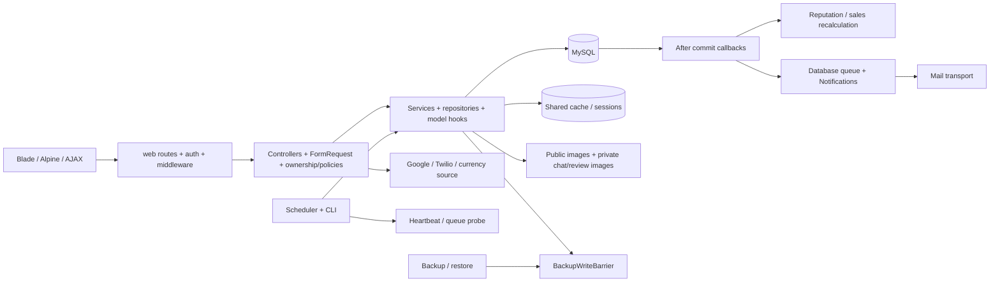

# WebVitrina: инвентаризация для технической приёмки production

Дата: 17 октября 2026 года (Europe/Chisinau). Этап 1: определение границ проверки.
Исходная ревизия: `59261f1bbdc5414b143947d6aa863c748658327b`; исследована текущая рабочая копия.

**Готовность к production этим документом не подтверждается.** Выполнено только статическое исследование исходников, конфигурационных шаблонов, миграций и тестов. Тесты, Artisan (включая read-only команды), сборка, миграции, команды обслуживания и запросы к БД не запускались. Рабочая БД `webv3` не использовалась. Фактические параметры сервера, данные, состояние миграций, очередей, backup и внешних сервисов неизвестны. Секретные `.env` и содержимое `test-results.txt` не читались. Исходники не изменялись; единственный создаваемый артефакт — этот документ. Commit/push не выполнялись.

Это реестр области будущей приёмки, а не отчёт о найденных дефектах. Указания «проверить» и оценки максимального ущерба не означают наличие подтверждённой ошибки. Исторические отчёты в `docs/` — контекст, а не доказательство работоспособности текущей ревизии.

**Итог инвентаризации:** 19 подсистем, 100 сценариев приёмки, из них 86 критических. В 61 строке найдены соответствующие автоматические тесты, в 30 — частичное покрытие, в 9 прямой тест не найден. Таким образом, зарегистрировано **39 пробелов покрытия** (30 частичных + 9 без прямого теста), а фактическое выполнение не подтверждено для всех 100 сценариев. Количество пробелов считается по строкам матрицы, не по числу тестовых файлов/assertions. Реальные интеграционные и staging-проверки нужны также строкам с покрытием Т.

## 1. Метод, объём и обозначения

Проверены статические объявления маршрутов и их привязки, точки регистрации middleware/observers/listeners, зависимости контроллеров и сервисов, модели и операции над данными, схема миграций, команды обслуживания, конфигурация, основные Blade/JS-потоки. Тестовый реестр составлен по методам, обращениям к маршрутам, fixtures, assertions и используемым fake/mock; подробная проверка корректности самих тестов остаётся задачей следующего этапа. Полный построчный поиск дефектов не проводился.

| Слой | Обнаружено файлов | Граница исследования |
|---|---:|---|
| Контроллеры | 61 | Включая базовый Controller, Auth, Seller и Admin |
| Middleware / policies / FormRequest | 8 / 2 / 6 | Дополнительно авторизация непосредственно в контроллерах и сервисах |
| Models / observers | 34 / 2 | Включая model hooks, soft delete, историю и пересчёты |
| Services / repositories | 25 / 2 | Деньги, файлы, телефон, workflow, backup, cache |
| Jobs / console commands | 3 / 9 | Дополнительно queued Notifications и closures событий |
| Конфигурация | 14 | PHP-конфиги; реальные env и config cache не подтверждены |
| Миграции | 96 | PHP-файлы, а не число применённых миграций |
| Blade / JavaScript | 214 / 8 | Особое внимание inline JS: приложение не ограничивается resources/js |
| PHP Feature / Unit | 70 / 9 | 648 объявлений `public function test_*`, включая ExampleTest |
| JS-тесты / вспомогательные процессы | 1 / 7 | Node-тест image fallback; workers для конкуренции и health |

648 — число объявленных методов, **не** число выполненных тестов, data-provider cases или покрытых требований. Два ExampleTest не являются самостоятельным доказательством бизнес-покрытия. Процент code coverage не измерялся. Каталог `app/Listeners` не обнаружен: обработчики событий есть в `AppServiceProvider`, моделях и observers.

Обозначения матрицы:

- **К** — критический сценарий: возможны утрата/раскрытие данных, неверные суммы/остатки/права либо остановка основной работы. **О** — обязательный вспомогательный сценарий приёмки.
- **Т** — найдены тесты, адресующие названный сценарий; это свидетельство предусмотренного покрытия, не его полноты или успешности.
- **Ч** — найдено частичное/косвенное покрытие; недостающая часть прямо названа.
- **Н** — прямой автоматический тест сформулированного сценария в исследованном наборе не найден. Это результат поиска по текущей копии, не утверждение о любых внешних тестовых системах.
- **СТ/НВ** — статически инвентаризировано / выполнение не проводилось. Этот статус относится ко всем строкам.
- **A** — будущая автоматическая проверка в изолированном тестовом окружении; **B** — браузер на собранном production frontend; **S** — staging с настоящими инфраструктурными компонентами; **I** — реальные внешние интеграции с разрешёнными тестовыми аккаунтами.

Названия PHP-тестов в матрице без пути означают `tests/Feature/<имя>.php`; `Auth/...` — подкаталог Feature/Auth, `Unit/...` — `tests/Unit`. Сокращения: **SR** = `SecurityRegressionTest`, **RE** = `ReleaseExperienceTest`. Приведённые методы после `::` имеют префикс `test_`, если он опущен для компактности. Перечисленные файлы сопоставляются только с указанным сценарием; соседние функции подсистемы автоматически покрытыми не считаются.

## 2. Архитектура и границы исполнения

### 2.1. Входы и доступ

Laravel-приложение с серверным Blade, Alpine и AJAX; MySQL хранит бизнес-данные. `composer.json` требует PHP `^8.4.1`, Laravel `^12.0`, Socialite, Intervention Image и Twilio SDK. Это ограничения зависимостей, не подтверждение установленной версии PHP/расширений/пакетов на сервере. Vite frontend использует Alpine, Axios, Chart.js, Leaflet, Cropper и intl-tel-input. `package.json` задаёт Node `^20.19.0 || >=22.12.0`; scripts — dev/build/preview, npm test script отсутствует.

Действительная объявленная точка сборки приложения — `bootstrap/app.php`: `routes/web.php`, `routes/console.php`, `/up`, добавление web middleware и alias `role` → `EnsureRole`. `bootstrap/providers.php` перечисляет `AppServiceProvider`. Файлы `app/Http/Kernel.php`, `app/Console/Kernel.php`, `AuthServiceProvider`, `RoleMiddleware` и `Http/Responses/LoginResponse` также существуют: их нельзя считать активными только по наличию. При последующей runtime-проверке установить фактическую регистрацию, policy discovery и обработку LoginResponse. В частности, не суммировать расписания двух Kernel/console-файлов как два подтверждённых запуска.

| Поверхность | Ключевые маршруты/группы | Объявленная граница |
|---|---|---|
| Публичная витрина | `/`, `/search`, `/search/suggest`, `/recommendations`, `/p/{identifier}`, `/category*`, `/seller/{identifier}`, `/u/{user}` | NormalizeCatalogInput на основных витринных маршрутах; public visibility проверяется также в коде |
| Публичные служебные страницы | `/up`, `/robots.txt`, `/sitemap.xml`, legal pages, `/countries/{country}/cities`, `/internal/currency/agroprombank`, POST `/currency` | `/up` — liveness; currency proxy имеет именованный throttle |
| Auth | register/login/remembered/logout, reset/confirm/update password, verify-email, Google redirect/callback | guest/auth, signed email link, route/request rate limits; OAuth отдельно в web.php |
| Общая авторизованная зона | profile, cart/favorites, addresses, orders/checkout, chats/support, notifications/settings, reviews/reports/follow | auth; verified на критических writes; ownership дополнительно в контроллерах/services/policies |
| Buyer | buyer profile/security, subscriptions | `role:buyer`; общая auth-группа не равнозначна buyer-only |
| Seller | `/seller/products`, orders, finance, analytics, followers, plans, category AJAX; shop phone/profile | `role:seller`; verified на изменении товара, магазина и операций заказа |
| Admin | `/admin/*`: users, products, categories/attributes/colors, orders, disputes, chats, reviews/reports, ads/banners, plans, activity, backups, checklist | auth + AdminMiddleware + verified; admin profile явно исключён из verified |
| Приватные изображения | `/review-images/{reviewImage}/{variant}`, chat image routes | Проверка статуса отзыва/автора/admin либо участника/контекста чата; наличие URL не означает публичный доступ |

Отдельные `routes/api.php`, routes для payment gateway/webhooks и websocket broadcasting в исследованном наборе не обнаружены. Упоминания API/услуг в описаниях тарифов не считаются реализованной интеграцией.

### 2.2. Сквозные зависимости и записи

Диаграмма показывает зависимости, а не универсальный pipeline: некоторые контроллеры пишут напрямую через Eloquent, часть проверок живёт вне policies. Cache участвует не только в скорости: checkout replay reservation, rate limiting, currency refresh lock и health heartbeat требуют отдельной приёмки.

Ключевые цепочки:

1. **Регистрация → User (+ Shop продавца) → verification mail → Login event → fingerprint сессии.** Назначение телефона использует общий PhoneAssignmentService и MySQL advisory lock; подтверждение — Twilio Verify.
2. **Checkout → token/cache reservation → общая DB transaction → отдельный Order на продавца → блокировка товара/остатки → OrderItem и snapshots → order_created → afterCommit notification.** Новый checkout: бесплатный pickup, cash/card продавцу при получении, без онлайн-списания и без адреса доставки.
3. **Pickup workflow v2:** pending → processing → ready_for_pickup; продавец независимо подтверждает оплату, покупатель — получение; завершение требует обоих фактов. Legacy определяется `workflow_version = null`. Неизвестная версия — отдельный режим, который должен оставаться без разрешённых переходов. Отмена, возврат остатка, reminders, события и статистика связаны.
4. **Изменение/удаление аккаунта или товара → история заказа продолжает жить.** Order/OrderItem содержат снимки контактов, адреса, продавца, названия/SKU/картинки и суммы/валюты. Backfill старых записей явно отличается от данных на момент покупки. User delete выполняет анонимизацию и soft delete; исторические продукты и заказы сохраняются.
5. **Review → moderation → ReviewObserver → post-commit пересчёт Shop; completion → sales count.** При ошибках предусмотрены recovery jobs. MessageObserver удаляет приватные изображения сообщений; Conversation удаляет сообщения через model hook. Эти пути требуют отдельной проверки транзакционных границ.
6. **Файлы и БД:** ProductImageOperation, ReviewImageOperation, ShopBannerOperation связывают создание/очистку файлов с commit/rollback; реальные файловые операции не становятся частью SQL-транзакции автоматически.
7. **BackupWriteBarrier:** кооперативный `flock` для поддерживаемых HTTP writes/jobs/service mutations и эксклюзивного backup/restore. Raw SQL, сторонние writers и migrations не следует считать защищёнными этой блокировкой. Нужен общий стабильный lock inode для всех процессов/release.

### 2.3. Модель данных: все обнаруженные доменные модели

| Группа | Модели | Критические связи |
|---|---|---|
| Идентичность | User, UserRememberedDevice, UserAddress | Роль, password/session credentials, контакты, devices; анонимизация не удаляет историю заказов |
| Продавцы | Shop, ShopFollower, SellerPlanRequest | Shop принадлежит User; followers, лимиты и решения по тарифу |
| Каталог | Product, ProductSlug, Category, Attribute, AttributeValue, Color, Country, City | Иерархия категорий, attribute_category/attribute_color, country-city, старые slug, soft-deleted products |
| Покупки | CartItem, Favorite, Order, OrderItem, OrderEvent, OrderAdminDecision, OrderDispute | Остаток/цена/валюта, buyer/seller scope, append-only история на уровне моделей, отдельные решения/споры |
| Отзывы и аналитика | Review, ReviewImage, ProductStat | Moderation + soft delete, private media, уникальные дневные counters, агрегаты Shop |
| Коммуникации | Conversation, Message, UserNotification | Buyer/seller/order/product context, раздельные read/hide/pin/admin flags |
| Администрирование/продвижение | ProductReport, AdminActivityLog, Banner, AdSlot, AdCampaign, AdImpression, AdClick | Блокировка продукта, аудит, рекламные targets/периоды/приоритеты/лимиты |

Служебные таблицы без отдельных доменных моделей: password_reset_tokens, sessions, cache/cache_locks, jobs/job_batches/failed_jobs, migrations; pivot-таблицы также входят в область миграций и backup. Гарантии `save/delete` модели не равны запрету изменений raw SQL — способ записи входит в дальнейший аудит.

### 2.4. Конфигурационные контракты

Все значения ниже — объявленные defaults/возможности исходников, а не считанная конфигурация работающего сервера.

| Файл | Что входит в будущую проверку |
|---|---|
| `config/app.php` | APP_ENV/DEBUG/URL/KEY/PREVIOUS_KEYS, maintenance, locale; timezone в коде UTC, локальное время этого документа Europe/Chisinau |
| `config/auth.php` | web/session guard, User provider, password broker/table/expiry/throttle/confirmation timeout |
| `config/session.php` | Default database, lifetime, encryption, domain/path/Secure/HttpOnly/SameSite, connection/table/store |
| `config/database.php` | Default sqlite без env override; целевой mysql, host/port/database, URL/read-write overrides, utf8mb4/collation/strict, TLS; Redis definitions не означают установленный Redis |
| `config/cache.php` | Default database; cache и cache_locks, prefix/connection и единый persistent backend для всех процессов |
| `config/queue.php` | Default database, retry_after default 90, after_commit default false; конкретные Notifications задают afterCommit; jobs/failed_jobs и default queue |
| `config/filesystems.php` | public → storage/app/public; local → storage/app/private; review_images → private/review-images; LOCAL_DISK_SERVE default false; public/storage symlink; S3 definition не доказывает использование |
| `config/services.php` | Google и Twilio Verify; также шаблонные Postmark/Resend/SES/Slack settings — без подтверждения их активной интеграции |
| `config/mail.php` | Default log; реальный SMTP/иной transport, from, TLS/domain/auth и очередь требуют отдельной проверки |
| `config/logging.php` | stack/daily, default retention 14 дней, отдельные twilio/registration; секреты/PII, disk usage, legacy logs и worker log rotation |
| `config/currency.php` | Checkout PRB; PRB_PER_MDL/PRB_PER_UAH; RUB нормализуется в PRB сервисом; реальные курсы/правило их изменения не подтверждены |
| `config/backup.php` | BACKUP_DIR default /var/backups/webvitrina, keep 14 дней, max age 30 часов, daily 03:15, stable lock path и timeout 60 |
| `config/health.php` | Scheduler age 5 минут, disk warning 1 GiB/critical 256 MiB; thresholds должны соответствовать инфраструктуре |
| `config/seller_news.php` | Контент/ссылки новостей кабинета; актуальность и доступность, без предположения о внешнем news service |

Внешние границы: сервер обращается к Google OAuth, Twilio Verify, mail transport и currency upstream; браузер — к OSM tiles/Nominatim, ui-avatars и YouTube. Платёжный gateway, автоматический refund, courier API и тарифный биллинг не обнаружены. Их нельзя включать в «проверено» или обещать пользователю на основании названий полей card/paid/finance/plan. Отдельно сверить фактические публичные обещания с реализованными возможностями.

## 3. Карта подсистем

Ни одна из перечисленных подсистем пока не имеет статуса «проверена». Сценарии и конкретные тесты ниже детализированы в матрице раздела 4.

### S01. Регистрация, вход, OAuth, пароль и сессии

- **Файлы:** `routes/auth.php`; `routes/web.php` (Google); `app/Http/Controllers/Auth/*`; `Http/Requests/Auth/LoginRequest.php`; `Services/PasswordSecurityService.php`; `Support/SafeRedirect.php`; `Models/User.php`, `UserRememberedDevice.php`; `Http/Middleware/EnsurePasswordSessionIsCurrent.php`; `config/auth.php`, `session.php`; `views/auth/*`.
- **Сценарии/данные:** регистрация buyer/seller, email/подтверждённый телефон для входа, Google provider identity, remembered devices, logout/forget, reset/change password. Создание User/Shop, password reset tokens, session regeneration/fingerprint, отзыв persistent credentials.
- **Тесты:** все `Auth/*`, `AccountDeletionTest`, `Unit/TestDatabaseGuardTest`; конкретные ветви S01-*.
- **Допроверка:** browser cookies/CSRF, OAuth state/callback/отмена и реальные credentials, повторные/просроченные reset, rate limits на общем cache, несколько устройств и процесс смены пароля в полёте.
- **Максимальный ущерб:** захват аккаунтов вплоть до администратора, массовая потеря доступа и раскрытие приватных данных (потенциальный P0/P1).

#### S01 — этап 2А: доказательства и границы результата

Продолжение 17.10.2026, ревизия `59261f1bbdc5414b143947d6aa863c748658327b`. Исходная инвентаризация выше и остальные разделы сохраняются как история этапа 1. Восстановлен итог **Auth audit** и сохранённые чтения **Phone profile audit / Baseline audit**; последние два не содержат итогового отчёта, поэтому не считаются независимым подтверждением выводов. Новые агенты не запускались. Дополнительно прослежены незакрытые пути remembered credentials, административного редактирования, конкурентной записи после удаления и файловых операций. Резервная копия `production-readiness-audit.before-S01-S03.md` не изменялась.

**Локальные статусы этапа 2А для S01–S03:** `2А/НВ` — исследованы пути исполнения и assertions, выполнение не проводилось; `F01…F09` — дефект доказан последовательностью операций в исходниках, но не воспроизведён запуском; `R` — риск с недоказанными условиями/масштабом; `ОТКР` — необходимая проверка остаётся открытой. Старое `СТ/НВ` в основной матрице сохранено слева от стрелки. Оценки покрытия этапа 1 не означают достаточности регрессионных тестов этапа 2А. **Все 16 сценариев S01–S03 остаются непринимаемыми без выполнения проверок; production-приёмка и аудит в целом не завершены.**

В пределах S01–S03 установлены **0 P0, 1 P1 и 8 P2**. Приоритет относится к конкретным последствиям и предпосылкам ниже, а не к гипотетическому максимуму подсистемы. Подтверждение по исходникам не подменяет MySQL/browser/staging-воспроизведение.

**Установленные механизмы, включая контрдоказательства:**

- Регистрация принимает только buyer/seller и явно перечисляет записываемые поля (`Auth/RegisteredUserController.php:42–47,84–104`); User/Shop создаются через транзакционный `PhoneAssignmentService::run`. Переданный admin/verified/provider не является разрешением на присвоение этих полей. Телефон при регистрации не становится подтверждённым.
- `LoginRequest.php:62–68` допускает вход по телефону только с `phone_verified_at`; парольный вход использует `Auth::attempt(..., false)`. Ограничения: маршрут 5/min плюс limiter логина/IP (`:85–107`). Вариации записи телефона не отменяют маршрутный лимит.
- Google callback использует stateful Socialite (`Auth/GoogleController.php:24`), выбирает аккаунт **по provider/provider_id**, отказывает при нескольких совпадениях (`:37–46`) и при конфликте email с локальным аккаунтом (`:49–53`). Для нового аккаунта нужен подтверждённый Google email (`:98–113`), роль фиксирована buyer, локальная email verification ещё требуется (`:63–79`). Автоматического связывания по одному email нет.
- State создаётся, извлекается из сессии и сравнивается через `hash_equals` до обмена кода в `vendor/laravel/socialite/src/Two/AbstractProvider.php:161–173,230–240,282–290`. Socialite fake в тестах этот код не исполняет. Отдельный явный `session()->regenerate()` не обязателен в каждом контроллере: `SessionGuard::login → updateSession` уже вызывает `regenerate(true)` (`vendor/laravel/framework/src/Illuminate/Auth/SessionGuard.php:567–598`). Session fixation по отсутствию такого вызова в GoogleController **не подтверждается**.
- `AppServiceProvider.php:39–43` привязывает сессию к точному hash пароля из Login event. `EnsurePasswordSessionIsCurrent.php:23–49` отвергает native recaller, отсутствующий/устаревший fingerprint и удалённого User, перечитывая credentials через write PDO. После ответа marker не обновляется. Ротация меняет пароль/remember_token и удаляет custom devices; текущая сессия при self-change явно перевыпускается и привязывается. Это защищает обычные последовательные запросы, но не гонку F01.
- Logout инвалидирует сессию и CSRF (`AuthenticatedSessionController.php:123–129`). Сохранение custom remembered accounts после logout предусмотрено интерфейсом и тестами; само по себе это не дефект logout. Токен устройства хранится в БД как SHA-256, проверяется constant-time и по expiry (`:67–72,134–155`).
- Активная web-цепочка определяется `bootstrap/app.php:18–29`, а не старым Kernel: стандартные cookie encryption/session/CSRF плюс password fingerprint и backup barrier. Barrier использует shared `LOCK_SH` для обычных записей (`BackupWriteBarrier.php:29`), поэтому не сериализует два HTTP writer. Наличие CSRF в цепочке не доказывает реальные cookie/proxy-настройки.

#### S01 — маршруты и доступ

Здесь и в S02 таблицы — **статическая матрица**, не результаты HTTP-запусков. `G` = guest; `B/S/A` = buyer/seller/admin; `u/v` = email unverified/verified; `+` = маршрут допускает до остальных проверок, `−` = запрет/redirect; `O` = только собственный ресурс, `F` = чужой. Guest не имеет meaningful verified/ownership. Phone verification — независимый признак, не эквивалент `verified`. GET включает HEAD, прочие не объявленные методы не получают разрешения от соседнего GET; `_method` должен проходить те же route gates. Для unsafe методов действует web CSRF; signed OAuth/email GET имеют собственные проверки.

| HTTP и путь | G | Bu/Bv | Su/Sv | Au/Av | Ownership и фактическая дополнительная проверка |
|---|---|---|---|---|---|
| GET `/register`, `/login`, `/forgot-password`, `/reset-password/{token}` | + | −/− | −/− | −/− | `guest`; GET reset лишь форма, не доказательство валидности token |
| POST `/register`, `/login` | + | −/− | −/− | −/− | `guest`, 5/min; регистрация whitelist; LoginRequest credentials |
| POST `/login/remembered` | + | −/− | −/− | −/− | 10/min; selector+token+expiry; F01 |
| DELETE `/login/remembered`, `/login/remembered/{selector}` | + | −/− | −/− | −/− | Все устройства — selectors из decrypted cookie; одиночное — body selector без проверки владения, R01 |
| POST `/forgot-password` | + | −/− | −/− | −/− | Именованный email+IP limiter и password broker |
| POST `/reset-password` | + | −/− | −/− | −/− | Broker email+token+expiry; F02 |
| GET `/auth/google/redirect`, `/auth/google/callback` | + | +/+ | +/+ | +/+ | Не `guest`-группа; state/provider identity; это вход, не endpoint связывания аккаунтов |
| GET `/verify-email`; POST `/email/verification-notification` | − | +/+ | +/+ | +/+ | Auth, собственная identity; отправка 6/min, verified short-circuit |
| GET `/verify-email/{id}/{hash}` | − | +/+ | +/+ | +/+ | Auth + signed + 6/min; id и email hash должны соответствовать текущему пользователю, F запрещён |
| GET/POST `/confirm-password`; PUT `/password` | − | +/+ | +/+ | +/+ | Auth, только O; пароль проверяется при наличии local password; F03 |
| POST `/logout` | − | +/+ | +/+ | +/+ | Только текущая сессия |

Источники всей таблицы: `routes/auth.php:14–74`, `routes/web.php:520–524`; user policies на этих endpoints не вызываются. Доступ к странице назначения проверяется её собственными middleware, redirect админа не предоставляет полномочий.

#### Подтверждённые проблемы S01

**F01 — P1: remembered credentials могут пережить конкурентную ротацию пароля.** S01-04, S01-05. Файлы: `app/Http/Controllers/Auth/AuthenticatedSessionController.php:32–42,67–80,134–155`; `app/Services/PasswordSecurityService.php:32–42`; `app/Providers/AppServiceProvider.php:39–42`.

Путь 1: A проходит `POST /login` со старым правильным паролем и `remember=1` → пауза после authenticate → B меняет/сбрасывает пароль и удаляет устройства, commit → A создаёт новое устройство по прежнему User id. Запись device не сравнивает credential version и не разделяет user lock с rotate. Старая сессия A будет отвергнута fingerprint middleware, **но новый device token** затем в отдельной гостевой сессии выполняет `/login/remembered`, загружает свежего User и получает fingerprint нового пароля. Предпосылка — владение старым паролем и совпадение запросов по времени; это не анонимный подбор токена.

Путь 2 той же причины: remembered request читает device → B удаляет его при rotate → eager-load `user` читает уже новый hash → A принимает ранее прочитанный token, несмотря на удалённую строку. `with('user')` выполняет отдельные чтения (`vendor/laravel/framework/src/Illuminate/Database/Eloquent/Builder.php:884–885`); результат `$device->update()` не проверяется. Ни issuance, ни redemption не имеют транзакционной проверки актуальности credentials. Последствие — сохранение доступа после операции, предназначенной для отзыва компрометированных credentials, включая admin при соответствующем исходном аккаунте.

Минимальное исправление: единый протокол сериализации rotate/issue/redeem по user row и проверка credential version/hash до выдачи полномочий; device связать с версией credentials. При возобновлении старой операции отказать; не перепривязывать старую авторизацию к новому hash. Регрессия: контролируемые паузы в обеих точках, self/reset/admin rotation, затем **отдельный HTTP-запрос защищённого ресурса с полученными cookies** должен быть отклонён, новые легитимные devices должны работать. Существующие тесты ротации проверяют уже созданные devices; stale Login test проверяет сессию, а не позднюю выдачу device.

**F02 — P2: ранее выданная неиспользованная reset-ссылка остаётся действительна после обычной/admin смены пароля.** S01-05. `app/Services/PasswordSecurityService.php:32–42` не удаляет broker tokens; `app/Http/Controllers/Auth/PasswordController.php:40` вызывает этот сервис. `vendor/laravel/framework/src/Illuminate/Auth/Passwords/PasswordBroker.php:155–165` и `DatabaseTokenRepository.php:81–100` проверяют email, срок и hash token, не версию пароля. При неизменном email и ещё действующем token смена пароля не отзывает ссылку; владелец ранее перехваченной ссылки может снова сменить пароль. Сам способ получения чужой ссылки не установлен. Минимум: инвалидировать outstanding broker token при каждой credential rotation в согласованной транзакционной границе. Тест: выдать token → self/admin change → старый token отклонён и hash неизменен; новый token работает; отдельно used/expired/wrong-user и конкурентная redemption.

**F03 — P2: проверка текущего пароля в авторизованной зоне не ограничивает перебор на уровне приложения.** S01-05, S01-06. `routes/auth.php:68–70`; `app/Http/Controllers/Auth/ConfirmablePasswordController.php:25–36`; `app/Http/Controllers/Auth/PasswordController.php:34–40`. Имея действующую сессию жертвы, можно многократно проверять кандидаты через POST confirm/PUT password, обходя limiter `/login`; подтверждение email не требуется. Правильный пароль расширяет временный доступ до устойчивого контроля. Это не доступный гостю oracle; наличие внешнего WAF не исследовано. Минимум: общий per-user budget для всех точек current-password validation, включая смену email/удаление профиля и admin self-profile, с дополнительным IP budget. Тест: чередовать endpoints, достичь общего лимита, проверить окно восстановления и независимость другого пользователя. `password.confirm` gate на бизнес-маршрутах не найден — его обход не заявляется.

#### S01 — assertions, пробелы и следующие проверки

| Сценарий | Что реально утверждает существующий тест (не запускался) | Что ещё добавить/выполнить |
|---|---|---|
| S01-01 | `RegistrationTest:20–49`: auth/redirect/no errors, нормализованный телефон; `PhoneUniquenessTest` проверяет одинаковый owner user/shop | Admin-role injection; обе роли и verification fields; rollback User+Shop при ошибке; session ID до/после регистрации |
| S01-02 | `AuthenticationTest:24–85,198–228`: email/verified phone, отказ unverified phone/неверного пароля/legacy hash | Порог/expiry limiter; нормализация ключа; старый session ID после login не авторизует |
| S01-03 | `GoogleAuthenticationTest:21–167`: email collision не связывает и не меняет чувствительные поля, provider identity входит, неоднозначность отклоняется, новый buyer unverified | Реальный Socialite state missing/mismatch/replay, отказ Google, missing/unverified email, session rotation, параллельные callbacks |
| S01-04 | `AuthenticationTest:88–195`: custom login/expiry/own forget; `PasswordSecurityRotationTest:18–108,145–172`: строки devices удалены, старый token не входит после последовательной ротации | Обе гонки F01; wrong token при верном selector; foreign-selector forget R01; несколько устройств и cookie round-trip |
| S01-05 | `PasswordResetTest:104–130`: hash и notification; `PasswordUpdateTest:14–49`: новый hash/ошибка current password; `PasswordConfirmationTest:22–44`: redirect/error. `PasswordSessionRevocationTest:30–213`: A сохраняется/B отозвана, database/file drivers, reset/admin, same-second, stale Login, in-flight marker, rollback/native recaller | F01/F02/F03; `auth.password_confirmed_at`; OAuth-only first local password и обязательный current password при второй смене; все failure/expiry/replay reset branches |
| S01-06 | `Unit/SecurityHeadersTest` проверяет headers, не browser cookies/CSRF; reset suite проверяет часть limiter | Настоящий CSRF (в обычных feature tests отключён), HTTPS/proxy/Secure/SameSite/HttpOnly; общие cache/session между workers; запросы после рестарта и конфигурационного cache |

`tests/TestCase.php:9–18` привязывает fingerprint для `actingAs`; этот shortcut не доказывает выполнение Login event. Независимые browser-session helpers в PasswordSessionRevocationTest сбрасывают guard/session drivers и закрывают более сильный контракт, но не F01.

**Потенциальные риски S01:** R01 — `forgetRemembered:86–99` удаляет по body selector без cookie/token proof: чужой известный случайный 32-символьный selector позволяет отзыв устройства, но способ его получения/угадывания не установлен, захвата аккаунта нет. R02 — reset responses различают состояния email и limiter email+IP не ограничивает суммарную рассылку по разным email; масштаб abuse зависит от списка адресов и provider quotas. R03 — provider pair имеет index, не unique; callback с несколькими записями отказывает, поэтому ошибочный вход при дубликатах не доказан. R04 — срок и защищённость bearer cookie, CSRF, OAuth callback URI/state-cookie и межузловой cache требуют браузера/staging; реальные env не читались.

### S02. Роли, ownership, email/phone verification

- **Файлы:** `bootstrap/app.php`, `AppServiceProvider`, `AuthServiceProvider`; `EnsureRole`, `AdminMiddleware`, `NormalizeCatalogInput`, `SecurityHeaders`; `Policies/ProductPolicy.php`, `CartItemPolicy.php`; `PhoneVerificationController`, `ShopPhoneVerificationController`; `PhoneNormalizer`, `PhoneAssignmentService`; `config/services.php`; migration `2026_10_03_000001_add_unique_phone_indexes.php`.
- **Сценарии/данные:** guest/buyer/seller/admin, доступ только к своему ресурсу, email signed links, ограничение критических writes до verification, смена/нормализация/уникальность телефона между user и shop, отправка и проверка SMS.
- **Тесты:** `RoleAccessTest`, `OwnershipAccessTest`, `Auth/EmailVerification*`, `PhoneUniqueness*`, `PhoneVerificationRaceTest`, `BuyerPhoneProfileTest`, `ShopPhoneProfileTest`, `Unit/PhoneNormalizerTest`.
- **Допроверка:** полная таблица «роль × endpoint × владелец × verified», actual policy discovery, HTTP+JSON failures, SMS TTL/retry/provider limits, реальные прокси/IP для throttling.
- **Максимальный ущерб:** повышение прав, доступ к чужим заказам/переписке, подтверждение чужого номера, расходы на SMS (P0/P1 в зависимости от масштаба).

#### S02 — этап 2А: полная матрица профильных endpoints

Обозначения G/B/S/A, u/v, O/F и ограничения статического результата — в S01. Профильные endpoints ниже вместе с auth-таблицей охватывают S01–S03; authorization заказов/товаров/чатов отмечена как смежная граница, а полный workflow остаётся в S05/S08/S10.

| HTTP и путь | G | Bu/Bv | Su/Sv | Au/Av | Ownership, controller/service checks |
|---|---|---|---|---|---|
| GET `/dashboard`, `/cabinet`, `/profile` | − | +/+ | +/+ | +/+ | Auth; выбор страницы/redirect по роли, без предоставления чужих ресурсов |
| GET `/profile/edit` | − | −/− | +/+ | −/− | `role:seller`; собственный профиль |
| PATCH `/profile` | − | +/+ | +/+ | +/+ | O из request user; whitelist секции, current password для смены email; F04/F06 относятся к альтернативным путям/гонкам |
| DELETE `/profile` | − | +/+ | +/+ | +/+ | O, current password; `User::delete`; нет last-admin guard, F07 |
| GET `/buyer/profile`, `/buyer/profile/security`, `/my-subscriptions`; PATCH `/buyer/profile/update` | − | +/+ | −/− | −/− | `role:buyer`; O; PATCH тот же ProfileController |
| PATCH `/profile/shop` | − | −/− | −/+ | −/− | `role:seller` + email verified; controller повторяет seller; fresh User lock → собственный Shop lock; phone assignment/banner operation |
| POST `/phone/send`, `/phone/verify` | − | +/+ | +/+ | +/+ | O; route 3/10 min и 3/min; service send 3/300s, verify 5/300s; Twilio и compare-and-set номера |
| POST `/shop/phone/send`, `/shop/phone/verify` | − | −/− | +/+ | −/− | `role:seller`; Shop из Auth user, не из payload; limiter send 3/300s, verify 5/300s внутри controller |
| GET `/addresses` | − | +/+ | +/+ | +/+ | Список `where user_id=auth id` |
| POST `/addresses` | − | −/+ | −/+ | −/+ | Email verified; user_id принудительно из auth |
| PUT `/addresses/{address}`; DELETE `/addresses/{address}`; POST `/addresses/{address}/default` | − | −/+ | −/+ | −/+ | O разрешён; F 403 для всех, включая admin; `authorizeOwner:98–100`; F05 |
| POST `/shops/{shop:slug}/follow` | − | +/+ | +/+ | +/+ | Auth + 30/min; чужой Shop разрешён; свой 422; привязка текущего user_id |
| GET `/seller/followers` | − | −/− | +/+ | −/− | `role:seller`; только свой shop relation |
| GET `/u/{user}`, `/seller/{identifier}` | + | +/+ | +/+ | +/+ | O/F публичная карточка; soft-deleted User не входит в обычный binding/query; `?chat=` только участник соответствующего seller |
| GET `/admin/profile`; PUT `/admin/profile` | − | −/− | −/− | +/+ | AdminMiddleware; явно без verified; только O, current password для sensitive change при local password; email change сбрасывает verification |
| GET `/admin/users`, `/admin/users/create`, `/admin/users/{user}`, `/admin/users/{user}/edit`; POST `/admin/users` | − | −/− | −/− | −/+ | AdminMiddleware + verified; управление пользователями, собственные whitelist/валидация, PhoneAssignmentService при записи |
| PUT/PATCH `/admin/users/{user}` | − | −/− | −/− | −/+ | O/F допустимы; last-admin demotion guard; phone uniqueness/reset; F04, F09 |
| DELETE `/admin/users/{user}` | − | −/− | −/− | −/+ | F допустим, O запрещён; last-admin count guard; `User::delete`; альтернативный self path F07 |

Источники: `routes/web.php:83–114,190–249,257–259,412–419,438–461,511–524,536–554,614–615`; `EnsureRole.php:14–19`; `AdminMiddleware.php:14–24`; `ProfileController.php:46–244,340–413,671–686`; `Admin/AdminProfileController.php:35–67`; `UserAddressController.php`; `ShopFollowController.php:10–36`; `Seller/FollowerController.php:10–35`. Имена этих контроллеров находятся в `app/Http/Controllers/`, middleware — в `app/Http/Middleware/`.

Для профиля/User/Shop/Address отдельных policies в проекте нет: защита реализована указанными middleware и явными проверками. Это не означает отсутствия авторизации. Смежные границы S02-02: `CartController.php:275,313` вызывает CartItemPolicy (строки 18–25, только owner); ProductPolicy (`:13–33`) даёт admin override, но `role:seller` route gate всё равно ограничивает seller endpoints; `OrderController.php:87` сверяет buyer id; `Seller/OrderController.php:115,124` — snapshot seller_id; `ChatController.php:587` проверяет участника, выдача image дополнительно сверяет conversation_id (`:432–440`). Эти проверки нельзя переносить на другой endpoint по совпадению имени ресурса. Несуществующие ID, foreign ID, JSON/HTML и method spoofing требуют отдельных assertions.

**Email:** signed URL + id/hash текущего email (`EmailVerificationRequest` фреймворка), auth и route throttle; обычный ProfileController сбрасывает verified при смене email и требует пароль. Admin self-profile делает то же. **Phone:** E.164-нормализация, общий MySQL `GET_LOCK` по номеру до транзакции, повторные cross-table проверки owner и unique indexes users.phone/shops.phone (`PhoneAssignmentService.php:34–53,84–158,167–195`; migration `2026_10_03_000001_add_unique_phone_indexes.php`). User и Shop одного владельца могут иметь один номер; разные владельцы — нет. Изменение номера обнуляет verification. Twilio approval применяется условным UPDATE `id + expectedPhone`; старое подтверждение другого номера не меняет новый (`PhoneVerificationController.php:98–145`, `ShopPhoneVerificationController.php:108–155`). Старые методы генерации/проверки кода в ProfileController/Shop не привязаны к текущим phone routes и не считаются вторым активным каналом.

#### Подтверждённая проблема S02

**F04 — P2: admin edit сохраняет подтверждение от прежнего email.** S02-03, S03-01. `app/Http/Controllers/Admin/UserController.php:209–245,259–265`; `app/Services/PhoneAssignmentService.php:34–50`. Verified admin выполняет PUT/PATCH `/admin/users/{user}` с новым email; `$userData` содержит email, но не сбрасывает `email_verified_at`, и service сохраняет attributes. В `User::booted:51–57` нет общего сброса email verification. Результат: новый непроверенный адрес наследует verified, критические маршруты остаются доступны. Это нарушение verification-контракта в привилегированном сценарии, не доказанное повышение роли обычного пользователя. Минимум: при реальном изменении email сбрасывать verification во всех writers (или оформлять отдельное явно аудируемое admin verification). Тест: изменить email через admin users update для verified target, проверить `email_verified_at=null`, отказ критических writes, доступность resend; неизменный email сохраняет подтверждение. `SecurityRegressionTest:4072–4107` утверждает новый email/phone/password, но не verification.

#### S02 — assertions и оставшиеся проверки

| Сценарий | Прямое/косвенное доказательство существующих tests | Открытый объём |
|---|---|---|
| S02-01 | `RoleAccessTest:16–108` проверяет несколько GET/redirect по ролям; `EmailVerificationPolicyTest::route_policy…` исследует middleware metadata, другие методы делают отдельные HTTP writes | Выполнить всю матрицу выше: все verbs, O/F, u/v, JSON/HTML, `_method`, отсутствие изменений/файлов после отказа; смена роли между auth и mutation |
| S02-02 | `OwnershipAccessTest:17–133`: чужие buyer/seller orders; cart qty/row остаются после отказа; чужие address update/delete/default не меняют street/default/row; чужой product запрещён | Полный набор по всем ролям/verbs, не только проверенные пары; direct service calls не получают гарантию middleware автоматически |
| S02-03 | `EmailVerificationTest:25–117`: Verified event/поле, wrong hash, foreign user, expiry, previous-email link; invalid-hash тест проверяет поле, не HTTP статус. Повтор signed link проверяет два redirect и verified=true, не число событий. Policy suite: unverified writes blocked, обычная смена email снимает доступ | F04; отсутствие повторных side effects при повторной signed ссылке; реальные host/proxy/TTL и доставка queued mail |
| S02-04 | `BuyerPhoneProfileTest`, `ShopPhoneProfileTest`: смена сбрасывает verification, неизменный номер сохраняет; cross-owner duplicate отказ. `PhoneVerificationRaceTest:18–168`: fake меняет phone во время verify, assertions проверяют новый номер/код и отсутствие verification; happy path допускает phone login. `PhoneUniquenessConcurrencyTest:24–71`: два отдельных процесса, lock contention, один success/один conflict и один владелец | Конкуренция user↔shop, shop↔shop; rollback/timeout, удаление владельца, смена номера туда-обратно; реальные MySQL isolation/locks и applied indexes |
| S02-05 | Verifier подменён; route auth и часть успешных/устаревших ответов предусмотрены тестами | Twilio expired/pending/denied, повторное использование, network failure/quota, общий cache, burst concurrency, фактические SMS user/shop |

**Риски, не подтверждённые дефекты:** R05 — сравнение phone по значению не различает историю A→B→A и перенос номера между владельцами; необходимо определить привязку Twilio challenge к пользователю/версии назначения и проверить provider TTL/replay. Одного предположения о поведении Twilio недостаточно для вывода о захвате. R06 — limiter `tooManyAttempts`/`hit` и cross-table phone invariant зависят от cache и соблюдения единого lock-протокола всеми writers; внешние записи/реальные индексы не проверялись. R07 — role/email могут измениться администратором после middleware уже начавшегося запроса; гарантии немедленной остановки таких операций не доказаны. Новые запросы перечитывают пользователя, а судьба in-flight writes требует согласованного контрактного теста.

### S03. Профили, магазины, адреса, подписки и удаление аккаунта

- **Файлы:** `ProfileController`, `PublicUserController`, `SellerController`, `ShopFollowController`, `UserAddressController`, `Seller/FollowerController`, `Admin/UserController`; `AccountDeletionService`, `UserTrustService`, `ShopBannerOperation`; User/Shop/ShopFollower/UserAddress; `views/buyer/profile*`, `seller/partials/*`, `profile/*`, `users/*`.
- **Сценарии/данные:** редактирование имени/email/телефона/аватара, магазина/соцссылок/баннера; публичная безопасная карточка, адресная книга и default address; follow/unfollow; self/admin delete. Анонимизация личных данных, отзыв сессий, cleanup файлов и связей при сохранении order history.
- **Тесты:** `ProfileTest`, phone profile suites, `AccountDeletionTest`, `AccountDeletionMigrationTest`, `OrderAddressSnapshotTest`, `ShopBannerLifecycleTest`, SR для follow/public profile.
- **Допроверка:** согласованный объём удаляемых/сохраняемых данных, concurrent delete с заказом/чатом/файлами, адресные CRUD/default race, уведомление пользователя об удалении и отдельная проверка восстановления исторических данных.
- **Максимальный ущерб:** необратимая потеря истории, утечка контактов либо остаточные персональные файлы (P0/P1).

#### S03 — этап 2А: установленные границы целостности и приватности

- **Профиль:** PATCH привязан к `$request->user()`, а не к user_id из формы. Секции personal/email/phone/contacts и общий fallback имеют собственные whitelist. Self email change требует current password и сбрасывает verified; Google-only пользователь сначала устанавливает локальный пароль. Phone change без current password — явно предусмотренное поведение с повторной SMS verification, а не доказанный захват аккаунта (`ProfileController.php:46–244,441–461`; phone profile tests).
- **Магазин:** `ProfileController.php:340–413` повторно проверяет роль, блокирует активную строку seller, затем Shop. Это сериализует конкурентное создание первого магазина через данный endpoint, включая отсутствие Shop. Phone advisory lock берётся раньше DB transaction; banner lifecycle использует `ShopBannerOperation`. Поле owner не берётся из payload. `shops.user_id` не имеет unique constraint (`2025_10_31_000001_create_shops_table.php:12–14`), поэтому вывод ограничен writers с этим протоколом; гарантии всех внешних writers нет. Конкурентные slug collisions и lost-update поведения ещё нужно выполнить на MySQL.
- **Адреса:** owner check есть для update/delete/default, список ограничен своим user_id; admin не получает обхода на пользовательском endpoint. Снимок старого адреса заказа независим от адресной книги. Новые checkout — pickup, `address_id` запрещён (`CheckoutController.php:305–308`), поэтому F05 не означает ошибочную текущую доставку.
- **Подписки:** toggle всегда действует от текущего user, свой Shop запрещён; seller followers выбирается через собственный shop relation. Unique `(shop_id,user_id)` предотвращает двойные строки, но не гарантирует корректную обработку двух одновременных toggle. Отсутствие email verified gate на follow — текущее явное правило маршрута.
- **Публичные данные:** `PublicUserController.php:11–46` возвращает Blade, не сериализацию целого User; reviews ограничены approved, public view показывает имя/аватар/агрегаты/статусы verification, не email и личный phone (`resources/views/users/partials/profile-content.blade.php`). Seller page загружает active products; `?chat=` проверяет участника и совпадение seller (`SellerController.php:124–140`). Follow JSON содержит following/count/message, avatar JSON — собственный avatar URL. Наличие email/phone в модели само по себе не означает их выдачи. Ошибки Twilio наружу обобщены; provider message попадает в server log, доступ/редакция журналов не проверялись. Полный browser/JSON/error-response scan с canary PII и реальным APP_DEBUG остаётся открытым.
- **Удаление:** `User.php:28–48` запрещает force delete, берёт row lock и общую DB transaction, повторное удаление возвращает false. `AccountDeletionService.php:21–83` удаляет conversations/messages/reviews/addresses/devices/preferences и связи, очищает credentials, оставляет анонимизированный soft-deleted User. Товары с order items блокируются и сохраняют stock; незаказанные удаляются; Shop удаляется. Order buyer/seller FK RESTRICT и order snapshots сохраняют историю. Это намеренно сохраняемые исторические контакты, не обещание удаления всех персональных сведений из заказа/backup/logs.
- **Файлы удаления:** `AccountDeletionService.php:85–113` откладывает cleanup до commit; ошибки логируются как retry required. Из этого не следует наличие автоматической гарантированной повторной очистки. Row lock удаления не останавливает writers, которые не проверяют active User под той же блокировкой (F06), и не включает upload в SQL transaction (F08/F09).

#### Подтверждённые проблемы S03

**F05 — P2: переключение default address не атомарно.** S03-04. `app/Http/Controllers/UserAddressController.php:26–37,46–57,79–85,124–127`; `database/migrations/2025_10_25_000000_create_user_addresses_table.php:12–24`. Между reset всех flags и set/create конкретного адреса нет transaction/user lock и ограничения единственного default. Два собственных запроса могут выполнить A.reset → B.reset → A.set(X) → B.set(Y): остаются два default. Ошибка после reset до set оставляет ни одного. Ownership при этом не нарушается, эффект ограничен своей адресной книгой. Минимум: единая транзакция и lock строки активного User для store/update/default (и согласованное правило удаления default); при необходимости DB constraint «не более одного». Тесты: два процесса на разных адресах, параллельные store+default, ошибка между reset/set с проверкой rollback и неизменности чужих адресов. Отсутствие default после намеренного удаления/снятия флага — отдельное продуктовое правило, не автоматически дефект.

**F06 — P2: запрос, начавшийся до удаления, может записать PII обратно в анонимизированную строку.** S03-01, S03-05, S02-04. `app/Http/Controllers/ProfileController.php:74–96`; `app/Services/PhoneAssignmentService.php:34–50`; `app/Models/User.php:38–47`; `app/Services/AccountDeletionService.php:69–83`. A проходит auth и получает User; B выполняет delete/anonymize и commit; A продолжает personal name/avatar save. Eloquent save обновляет по PK без soft-delete scope (`vendor/laravel/framework/src/Illuminate/Database/Eloquent/Model.php:1219,1316,1355,1608`), поэтому dirty name/avatar снова записываются. Для phone путь ещё явнее: service блокирует `withTrashed()` User и не отклоняет trashed. Последствие — нарушение завершённой анонимизации, повторное сохранение личного номера/имени/публичного avatar после cleanup. `deleted_at` остаётся, успешное восстановление входа **не заявляется**. Минимум: повторное чтение только активного User под lifecycle lock во всех writers; serialize с delete; rollback/cleanup uploaded files при отказе. Тест: пауза между auth и mutation, delete commit, продолжение personal/phone/admin update; trashed запись остаётся анонимной, новых файлов/зависимых данных нет.

**F07 — P2: защита последнего администратора обходится собственным profile deletion.** S03-05, S02-01. `routes/web.php:202,219`; `app/Http/Controllers/ProfileController.php:671–681`; `app/Http/Controllers/Admin/UserController.php:281–292`. Единственный admin с известным ему текущим паролем отправляет DELETE `/profile`: общий auth endpoint допускает admin, `User::delete` не проверяет остаток admin, а guard last-admin существует только в admin users controller. Все активные администраторы могут исчезнуть, управление придётся восстанавливать вне UI. Это действие самого привилегированного пользователя, не escalation buyer/seller; поэтому P2. Минимум: вынести инвариант удаления/понижения последнего admin в общую сериализованную операцию и применять ко всем endpoints; простого `count` до транзакции недостаточно для двух одновременных понижений. Тест: DELETE `/profile` последним admin отклонён, User/связи сохранены; два admin одновременно demote/delete не оставляют ноль. `SecurityRegressionTest:3938–3961` проверяет только admin.users routes и не покрывает этот альтернативный путь.

**F08 — P2: изображение сообщения остаётся на диске при удалении диалога аккаунта перед INSERT.** S03-05 (граница S10/S12). `app/Http/Controllers/ChatController.php:336–366`; `app/Services/ChatImageService.php:21–30`; `app/Services/AccountDeletionService.php:23–28,104–111`; `database/migrations/2026_05_17_000003_create_chat_tables.php:23`. A — второй участник — проходит participant check и загружает image; B удаляет аккаунт/диалог и делает commit до message INSERT; A получает FK failure на отсутствующий conversation. Файл уже записан, отсутствует в deletion snapshot и не удаляется catch/rollback у store. Последствие — остаточное приватное вложение на диске без строки сообщения, рост storage; публичная доступность файла не доказана. Минимум: компенсирующая очистка upload при любом провале записи, согласованный lock conversation/delete и file lifecycle afterCommit/rollback. Тест: пауза после upload до INSERT, удаление собеседника, продолжение send; ни сообщения, ни файла; отдельно DB failure после успешного upload. Проверять также вставку между snapshot файлов и удалением conversations.

**F09 — P2: admin avatar replacement удаляет старый файл до успешного сохранения данных.** S03-01. `app/Http/Controllers/Admin/UserController.php:249–261`; `app/Services/PhoneAssignmentService.php:91–104`. PUT/PATCH admin users update с avatar сначала сохраняет новый файл и удаляет старый, затем пытается взять phone lock/сохранить User. Например, timeout занятого phone lock после успешного upload приводит к ValidationException: в БД остаётся старый avatar path, его файла уже нет; новый файл не очищается. Предварительная проверка уникальности не исключает последующего timeout/DB failure. Минимум: файловая операция как у ShopBannerOperation — удаление старого только afterCommit, нового при rollback/ошибке; DB mutation единым блоком. Тест: успешный image processing, затем controlled phone lock/save failure; старые medium/thumb существуют, User не изменён, новые файлы отсутствуют; success удаляет старые после commit. Тест ошибки image processing не достигает этой ветви.

#### S03 — assertions, открытые риски и критерии закрытия

| Сценарий | Что утверждают существующие тесты | Недостающие проверки |
|---|---|---|
| S03-01 | `ProfileTest:25–95`: имя/email сохранены, verification сброшена либо сохранена при неизменном email, current password обязателен; Google-only получает требование установить пароль. Phone profile suites проверяют нормализацию/duplicate/reset verification. `SR:2153–2174` явно исключает private email и phone из public HTML | F04/F06/F09; canary email/phone/address/provider/code в HTML, JSON, validation/error responses, seller widget/followers и private browser cache; параллельные профильные секции |
| S03-02 | `ShopBannerLifecycleTest:38–99`: DB path и medium/thumb заменены при успехе, при принудительном save failure старые файлы/имя остаются, новых нет. ShopPhoneProfileTest проверяет verification и cross-owner collisions; SR проверяет запрет buyer write и slug | Два MySQL процесса создают первый Shop; concurrent banner replace/remove и phone edits; delete owner между auth и lock; slug collision, outer rollback и сбой файловой очистки |
| S03-03 | SR проверяет follow/unfollow, запрет своего Shop, отображение followers через seller panel | Два одновременных toggle, повтор HTTP, deleted shop, pagination и отсутствие чужих приватных полей; итог row/count должен соответствовать принятому контракту |
| S03-04 | OwnershipAccessTest проверяет foreign update/delete/default и неизменность данных; OrderAddressSnapshotTest — независимость истории заказа | F05; полный own CRUD/default lifecycle, failure rollback, две независимые MySQL connection; правило удаления последнего/default адреса |
| S03-05 | `AccountDeletionTest:25–183`: soft delete/PII null, исчезновение связей и файлов, sessions/devices отозваны, новая email/OAuth identity не наследует заказы, seller catalogue blocked/unsold removed, stock и orders сохранены, SQL FK отвергает physical delete. Migration suite проверяет upgrade history | F06/F07/F08; удаление параллельно checkout/payment/receipt/cancellation/chat/upload, file failures/retry, rollback, настоящий staging restore |

**Ограничение assertions удаления:** `AccountDeletionTest::all_order_states_items_and_money_survive_self_deletion_and_remain_viewable` создаёт заказы через legacy helper (`workflow_version=null`) и `Order::allStatuses()`. Название «all» не доказывает прохождение pickup v2 `ready_for_pickup`, двух независимых подтверждений payment/receipt или unknown workflow. Нужны явные fixtures v2/unknown и assertions orders/items/events/stock/snapshots/notifications после удаления, включая порядок конкурирующих commit.

**Риски/непроверенные сценарии S03 (не добавляются к подтверждённым дефектам):**

- R08 — delete ↔ checkout/status transition: checkout создаёт Order внутри transaction, model hook читает buyer/seller (`CheckoutController.php:387–422`, `Order.php:39–45`), затем блокируются продукты; удаление блокирует User. FK RESTRICT защищает физическую историю, но soft-delete/lifecycle, lock order, snapshot timing и обработку deadlock нельзя признать безопасными без согласованной проверки обоих порядков commit. Утрата заказов по одному отсутствию общего mutex не доказана.
- R09 — delete cleanup failure оставляет file, логирует retry required; наличие исполняемого recovery/reconciliation процесса и удаление остаточных public URLs/CDN не подтверждены. Нужны failure injection, повтор и мониторинг. Сохранённые order contact snapshots, audit logs, mail jobs и backup требуют отдельной согласованной retention-модели; сами по себе не объявлены утечкой.
- R10 — first-Shop invariant защищён конкретным controller lock, не unique user_id; внешние writers, параллельные slug, смена роли после auth и side effects model hooks требуют выполнения. Follow toggle не идемпотентен; требование retry semantics надо зафиксировать до оценки результата.
- R11 — код публичных шаблонов и выборочные privacy assertions не доказывают безопасность реальных error pages, HTTP cache/CDN и логов. APP_DEBUG, document root/storage permissions, cookie transport, production headers и доступ к backup не исследованы в окружении.

**Очередь дальнейших работ и критерии закрытия именно S01–S03:**

1. Сначала воспроизвести F01 двумя контролируемыми запросами/соединениями и закрыть P1 с регрессией issuance/redeem → rotate → защищённый запрос; затем F02/F03 и credential lifecycle во всех endpoints.
2. Выполнить матрицы доступа S01/S02 с assertions отсутствия побочных эффектов; закрыть F04/F07 и проверить конкурентное понижение роли, email/phone challenges.
3. Закрыть F05/F06/F08/F09, проверить MySQL гонки адресов/магазина/удаления и все pickup v2 состояния. Файловые проверки должны утверждать состояние БД **и** medium/thumb/private файлов при commit/rollback/failure.
4. Выполнить новые и существующие тесты в изолированной тестовой среде; зафиксировать ревизию, команды, окружение и фактические результаты, затем полный suite. В этом этапе запусков нет.
5. Отдельно browser/staging: Google state/callback, Twilio и SMTP/queue, CSRF/cookies/HTTPS/proxy/cache, применённые индексы и locks, privacy ошибок, backup restore. Все R01–R11 закрыть доказательством либо явно оставить непроверенными с владельцем решения. Отсутствие подтверждённых P0 не означает выполнения production gate.

### S04. Товары и справочники

- **Файлы:** `Seller/ProductManageController`, `Admin/ProductController`, `Admin/CategoryController`, `Admin/CategoryAttributeController`, `Admin/ColorController`, `Seller/CategoryController`; четыре Product FormRequest; `ProductService`, `AttributeService`, `CategoryService`; `ProductCrudRepository`, `ProductRepository`; Product/ProductSlug/Category/Attribute/AttributeValue/Color/Country/City; `views/seller/products/*`, `admin/products/*`, `admin/categories/*`, `admin/colors/*`.
- **Сценарии/данные:** CRUD, active/draft/blocked, SKU/slug history, цена/скидка/валюта/остаток, принадлежность seller, страна-город, gallery, дерево категорий, варианты атрибутов и цвета. Изменение связей и инвалидация cache, soft delete и purge.
- **Тесты:** `AdminProductValidationTest`, `ProductCountryCityValidationTest`, `ProductSlugTest`, `ProductImageLifecycleTest`, `OwnershipAccessTest`, `MoneyIntegrityTest`, SR для справочников и seller CRUD.
- **Допроверка:** конкурентный SKU/slug и перенос владельца, все типы атрибутов, удаление используемых справочников, ограничения тарифов при одновременных публикациях, цветовые CRUD и cache после изменений дерева.
- **Максимальный ущерб:** массовая порча каталога/остатков/цен, публикация скрытого товара, разрушение связей истории (P1, при массовой потере P0).

### S05. Каталог, поиск, фильтры и рекомендации

- **Файлы:** `ProductController`, `CategoryController`, `SellerController`; `ProductRepository`; `CategoryService`, `CategoryCacheService`, `CategoryFilterCacheService`; `Support/CatalogAttributeFilters.php`; `RememberLocation`, `NormalizeCatalogInput`; `views/shop/index`, `shop/recommendations`, `shop/product-show`, `categories/*`, `seller/show`, `partials/*`; `resources/js/catalog.js`.
- **Сценарии/данные:** home/category/shop/search/suggest, SKU/substring/FULLTEXT, сортировки, location/session, filters, load more, legacy slug redirect, скрытие недоступных товаров. Чтения с cache, запись view counters и выбранной географии.
- **Тесты:** `ProductSearchTest`, `PublicCatalogValidationTest`, `CategoryAjaxResultsTest`, `ProductSlugTest`, `ProductStatTest`, SR/RE для visibility и страниц.
- **Допроверка:** FULLTEXT/коллация на целевом MySQL и реальном объёме, latency/EXPLAIN, все виды invalidation, гонки AJAX, браузерное восстановление URL/фильтров и zero-results.
- **Максимальный ущерб:** недоступность витрины или массовая неверная выдача, показ закрытых товаров/данных (P1; отдельные UI-сбои P2).

### S06. Корзина и избранное

- **Файлы:** `CartController`, `FavoriteController`, `CartItemPolicy`; CartItem/Favorite/ProductStat; `views/shop/cart`, `shop/favorites`, `components/product-card`, `components/product/buy-box`, `favorite`; `resources/js/app.js`, `AppServiceProvider` (nav counters).
- **Сценарии/данные:** add/update/remove, toggle, перенос/добавление выбранного избранного в корзину, сумма qty и stock guard, unavailable items, own-product restriction. User row lock, счётчики и уникальность строк, JSON и HTML формы.
- **Тесты:** `FavoriteCartIntegrityTest`, `OwnershipAccessTest`, `ProductStatTest`, SR для stock/JSON/quantities/unavailable/favorites.
- **Допроверка:** одновременные действия нескольких вкладок/процессов и синхронизация UI после Back/pageshow, сеть/419/422/429; фактический DB constraint и результаты retry.
- **Максимальный ущерб:** неверные количества/суммы перед заказом, чужая корзина, потеря выбора покупателя (P1/P2).

### S07. Checkout и денежные расчёты

- **Файлы:** `CheckoutController`, `CurrencyController`, `CurrencyProxyController`; `CurrencyService`, `MoneyLimits`, `OrderIdentitySnapshot`; Order/OrderItem/Product/CartItem; `config/currency.php`; `views/shop/order-confirm`; `resources/js/currency-rates.js`.
- **Сценарии/данные:** quick/cart/selected checkout, подтверждение новой цены, session token + cache replay reservation, split по seller в одной транзакции, decrement stock, снимки цены/курса/валюты. Новый заказ: pickup с нулевой доставкой, cash/card при получении, `workflow_version=2`, unpaid; клиентские lifecycle-поля не принимаются как источник истины.
- **Тесты:** `CheckoutCurrencyTest`, `CheckoutDeliverySemanticsTest`, `CheckoutPickupWorkflowTest`, `CheckoutNotificationTest`, `MoneyIntegrityTest`, `CurrencyProxySecurityTest`, `Unit/CurrencyServiceTest`, SR для token/stock.
- **Допроверка:** независимые покупки последней единицы, настоящий общий cache и session, сбой между commit и HTTP-ответом, изменение цены/курса/seller, границы DECIMAL, согласованность отображаемого курса с серверным. Proxy банка и серверный CurrencyService — разные источники: серверная конвертация берёт config.
- **Максимальный ущерб:** дубли заказов, oversell, неверные финансовые обязательства и потеря данных нескольких продавцов (P1, массовая порча P0). Онлайн-платёжный шлюз в scope отсутствует.

### S08. Заказы, самовывоз, отмена и исторические снимки

- **Файлы:** `OrderController`, `OrderStatusController`, `Seller/OrderController`, `Admin/OrderController`; `OrderPickupWorkflow`, `OrderIdentitySnapshot`; Order/OrderItem/OrderEvent/OrderAdminDecision; `views/shop/order-show`, `orders`, `seller/orders/*`, `admin/orders/*`, `components/order-timeline`; миграции snapshots/pickup.
- **Сценарии/данные:** списки и action tabs по ролям, обработка/готовность/оплата/получение/completed, cancellation request/reject/accept, restock один раз, reminder/cooldown, legacy/unknown workflow. Под блокировкой изменяются order, stock, events, notifications и последующая статистика; история событий и snapshots защищена на уровне модели.
- **Тесты:** все `Pickup*`, `UnsupportedOrderWorkflowTest`, `OrderStock*`, `OrderIdentitySnapshotTest`, `OrderAddressSnapshot*`, `OrderSellerChatSnapshotTest`, `OwnershipAccessTest`, `SellerSalesAfterCommitTest`.
- **Допроверка:** вся таблица разрешённых/запрещённых переходов и повторов для всех ролей; несколько процессов; реальные действия на выдаче, покупатель с удалённым аккаунтом, full history после deploy/restore, разграничение dispute resolution и изменения order lifecycle.
- **Максимальный ущерб:** выдача/завершение без правильного подтверждения, двойной restock, искажение доказательств покупки и массовая порча заказов (P0/P1).

### S09. Отзывы, репутация, статистика и финансы продавца

- **Файлы:** `ReviewController`, `Admin/ReviewController`; `ReviewObserver`; Review/ReviewImage/ProductStat/Shop; `Seller/AnalyticsController`, `FinanceController`, `CabinetController`, `Admin/DashboardController`; `UserTrustService`; `Jobs/RecalculateSellerReputation`, `SyncShopSalesCount`; `RecalculateShopReputation` command; review/analytics/finance/dashboard views.
- **Сценарии/данные:** отзыв по завершённой покупке, moderation и причины, повторная подача soft-deleted review, рейтинг только approved, статистика views/cart/favorites/sales, агрегаты по датам/ролям/валюте. Внешний платёж/вывод денег не обнаружен: finance — учётная страница заказов.
- **Тесты:** `SellerReputationTest`, `SellerMetricsConcurrencyTest`, `SellerSalesAfterCommitTest`, `ProductStatTest`, `PickupOrderStatisticsTest`, `UnsupportedOrderWorkflowTest`, SR для reviews/dashboard.
- **Допроверка:** recovery jobs с реальным worker, статистика при смене владельца/удалении/другой валюте, даты UTC, ограничения advanced analytics по тарифу, конкурентные counters и backfill на крупном наборе.
- **Максимальный ущерб:** ложная репутация и финансовая отчётность, отзывы неавторизованных лиц, потеря доверия и ошибочные решения продавцов (P1/P2).

### S10. Чаты и поддержка

- **Файлы:** `ChatController`, `Admin/ChatController`, seller order chat action; Conversation/Message; `MessageObserver`; `ChatImageService`; `views/chats/*`, `chats/partials/widget`, `admin/chats/index`, `buyer/support/index`.
- **Сценарии/данные:** general/product/order/support context, reuse диалога, отправка текста/изображения, batches older/newer, read/admin-read, pin/hide, internal note, lock/unlock. JS widget опрашивает новые сообщения каждые 5 секунд; отдельного websocket слоя не обнаружено.
- **Тесты:** SR содержит сценарии отправки, privacy, pagination/read, admin moderation/support, hide/note; `OrderSellerChatSnapshotTest`, `OrderIdentitySnapshotTest`, `ReviewImagePrivacyTest` не заменяет chat image tests.
- **Допроверка:** browser polling/reconnect/scroll, одновременные send/reuse, lock/unlock во время запроса, нагрузка множества вкладок, cleanup при DB failure и удалении участника; приватность вложений через реальный web server.
- **Максимальный ущерб:** раскрытие чужой переписки/вложений или внутренних заметок, потеря доказательств обращения, недоступность поддержки (P1).

### S11. Уведомления и настройки

- **Файлы:** `UserNotificationController`, `UserSettingsController`; `UserNotificationService`; `Notifications/VerifyEmail`, `ResetPasswordNotification`, `PasswordChangedNotification`, `MarketplaceEventNotification`; UserNotification/User; `views/notifications/*`, `buyer/notifications/settings`, `buyer/settings/*`, `emails/*`; `config/mail.php`.
- **Сценарии/данные:** site inbox/read/read-all, безопасный redirect, сохранение предпочтений email/site/язык/валюта, уведомления по заказу/чату/отзыву/спору/модерации, verification/reset/security mail. Сайт хранит собственные user_notifications; четыре Notification-класса используют очередь и afterCommit.
- **Тесты:** RE, `CheckoutNotificationTest`, Auth password/email suites, `Unit/ProductionHealthTest` для границ health.
- **Допроверка:** семантика каждого preference для каждого event, чужие notification IDs/read-all, локализация фактических страниц, SMTP deliverability, queued retry/duplicate и события после удаления получателя.
- **Максимальный ущерб:** потеря обязательных уведомлений и восстановления доступа, утечка информации через письмо/redirect, спам при retry (P1/P2).

### S12. Загрузка, хранение, выдача и удаление файлов

- **Файлы:** `ImageUploadConstraints`, `ImageService`, `ProductImageOperation`, `ReviewImageOperation`, `ReviewImageStorage`, `ShopBannerOperation`, `ChatImageService`, `OrderIdentitySnapshot`; `Support/PublicImage`; `ReviewImageController`; `config/filesystems.php`; image hooks и `MigrateReviewImagesToPrivate`; `resources/js/image-fallback.js`, cropper scripts/views.
- **Сценарии/данные:** raster validation, размеры/пиксели/число файлов, WebP medium/thumb, public products/avatar/banner/category/order-snapshots, private chat-images и private review-images. DB reference ↔ file lifecycle, rollback/new file cleanup, afterCommit removal, shared references, legacy fallback и перенос review media.
- **Тесты:** `Unit/ImageServiceTest`, `Unit/ProductImageUrlTest`, `Unit/PublicImageFallbackTest`, `ProductImageLifecycleTest`, `ShopBannerLifecycleTest`, `ReviewImagePrivacyTest`, `ReviewImageMigrationTest`, SR, `tests/js/image-fallback.test.mjs`.
- **Допроверка:** реальный GD/WebP/PHP memory/temp/upload limits и дисковые права, crash/disk full, legacy public URLs после переноса, storage symlink, HTTP cache/CDN и приватность после moderation/delete, recovery orphan files.
- **Максимальный ущерб:** массовое удаление изображений/истории, раскрытие private media, отказ сервера при обработке файлов (P0/P1).

### S13. Администрирование, модерация, жалобы и споры

- **Файлы:** `Admin/UserController`, `AdminProfileController`, `DashboardController`, `ActivityLogController`, `ProductReportController`, `OrderDisputeController`, `ReviewController`, `ChatController`; публичные `ProductReportController`, `OrderDisputeController`; `AdminActivityLogger`; ProductReport/OrderDispute/AdminActivityLog/OrderAdminDecision; `views/admin/*`.
- **Сценарии/данные:** управление users/role/password, защита последнего admin, moderation product/review/chat, report queue, hide/restore blocked product, resolve/close dispute и журнал решений. Полномочия и аудит должны проверяться для каждой write-операции.
- **Тесты:** `RoleAccessTest`, SR admin/profile/review/chat, RE reports/disputes, Auth password rotation, `AccountDeletionTest`, `SellerReputationTest` bulk moderation.
- **Допроверка:** два администратора одновременно, повторные решения и доставка уведомлений при частичном сбое, полнота actor/before-after/reason в журнале, фильтры и privacy admin exports/страниц, distinction dispute vs order completion.
- **Максимальный ущерб:** административный захват/блокировка площадки, изменение чужих данных, удаление последнего администратора, недоказуемые решения по спорам (P0/P1).

### S14. Тарифы продавца, баннеры и реклама

- **Файлы:** `Seller/PlanController`, `Admin/SellerPlanRequestController`, `Admin/AdCampaignController`, `Admin/BannerController`; `SellerPlanService`; SellerPlanRequest/Banner/AdSlot/AdCampaign/AdImpression/AdClick; `ProductController`, `CategoryController`, Shop cache hooks; `views/seller/plans/*`, `admin/ads/*`, `admin/banners/*`.
- **Сценарии/данные:** starter/basic/pro/business/enterprise; лимиты товаров 10/25/50/100/unlimited; request/approve/reject и downgrade; баннеры для устройств; рекламный target product/shop/custom, категория, сроки, приоритет, label, max_impressions и агрегаты.
- **Тесты:** SR для plan limits/request/approve/downgrade и banner processing; RE для создания/выборки/приоритетов/категорий/кэша ads.
- **Допроверка:** reject/retry/concurrent approval и публикация на границе лимита, полный ads update/delete/expiry/limit, источник impressions/clicks. Модели счётчиков и отображение totals найдены; отдельный публичный tracking route в routes не найден. Наличие моделей не подтверждает сбор статистики или биллинг.
- **Максимальный ущерб:** обход коммерческих ограничений, неверное размещение рекламы/метрики, потеря баннеров или опасные ссылки (P1/P2).

### S15. Очереди, scheduler и команды обслуживания

- **Файлы:** `routes/console.php`, `Console/Kernel.php`, `AppServiceProvider`; `Jobs/*`; все девять `Console/Commands/*`; `config/queue.php`, `cache.php`; `deploy/supervisor-webvitrina-worker.conf.example`; `tools/*local-background.ps1`.
- **Сценарии/данные:** mail/recovery jobs, retries/backoff, heartbeat/probe, purge soft-deleted products старше 90 дней без разрушения order history, backfill/recalculate/migrate-private по явной процедуре. Scheduler: heartbeat каждую минуту, queue probe раз в 5 минут, backup default 03:15, purge 03:30; время приложения по config — UTC.
- **Тесты:** `OperationalHealthTest`, `Unit/ProductionHealthTest`, RE queue probe, `PurgeOrderHistoryTest`, `ProductImageLifecycleTest`, `SellerReputationTest`, `OrderIdentitySnapshotTest`, `ReviewImageMigrationTest`.
- **Допроверка:** реальный process manager/cron/reboot/release restart, shared cache, job timeout vs retry_after, конкуренция команд, drained writers и failed_jobs; локальные Windows scheduled tasks не подтверждают Linux production.
- **Максимальный ущерб:** остановка почты/verification/обслуживания, незаметное старение backup, повторные побочные эффекты и destructive purge (P0/P1 по последствиям).

### S16. Backup и восстановление

- **Файлы:** `RunBackup`, `RestoreBackupFiles`, `BackupHealthCheck`; `BackupStorageService`, `RestoreDestination`, `BackupWriteBarrier`; `Support/BackupHealth`; `Admin/BackupController`; `config/backup.php`; `docs/release-runbook.md`, `backup-restore-safety.md`, `local-backup.md`.
- **Сценарии/данные:** consistent MySQL/InnoDB dump на отдельном соединении, DB+public+private chat+private review archives, manifest v3/SHA256, staging-directory publication, retention; isolated file drill и явный live restore. SQL import — отдельная операция; restore-files не восстанавливает БД/код/секреты.
- **Тесты:** `BackupSnapshotTest`, `BackupAtomicityTest`, `BackupWriteBarrierTest`, `PrivateBackupTest`, `SafeRestoreTest`, RE/OperationalHealth backup checks.
- **Допроверка:** полный цикл SQL import + все storage + smoke + privacy на staging, размер/длительность, обрыв/ENOSPC, RPO/RTO, независимая копия вне сервера, доступность APP_KEY/code/build, v2→v3 compatibility и повтор после частичного восстановления. Checksums сами по себе не доказывают восстановимость.
- **Максимальный ущерб:** необратимая потеря всей площадки и/или раскрытие backup с личными данными (P0).

### S17. Миграции, начальные данные и совместимость

- **Файлы:** `database/migrations/*` (96), `database/seeders/*`, `database/factories/*`, `config/database.php`; commands backfill/recalculate/migrate-private; `tests/TestCase.php`, `phpunit.xml`.
- **Сценарии/данные:** fresh install и upgrade существующей MySQL-схемы, FK/unique/enum/index/JSON/DECIMAL, snapshots backfill, phone preflight, pickup history, review soft delete; controlled reference/admin seeds.
- **Тесты:** `AccountDeletionMigrationTest`, `OrderAddressSnapshotMigrationTest`, `PickupOrderSchemaCompatibilityTest`, `PhoneUniquenessTest`, `OrderIdentitySnapshotTest`, `Unit/TestDatabaseGuardTest`; RefreshDatabase в feature suites — косвенное свидетельство пути fresh schema, не результат запуска.
- **Допроверка:** реальная исходная schema/версии/коллации/DDL locks, upgrade на копии staging, partial migration и recovery; seed идемпотентность и отсутствие demo/admin-reset побочных эффектов. Файл `database/schema/mysql-schema.(sqlкажется не нужен)` не считать актуальным schema dump без отдельной верификации.
- **Максимальный ущерб:** невосстановимая история, несовместимый релиз и остановка сайта (P0/P1).

### S18. Production deployment, конфигурация и наблюдаемость

- **Файлы:** `bootstrap/*`, `config/*`, `composer.json/lock`, `package.json/lock`, `vite.config.js`, `public/index.php`, `LivenessController`, `Support/ProductionHealth`, `DiskSpace`, `ProductionHealthCheck`, `QueueHealthCheck`; `deploy/*`, `deploy.bat`, `PRODUCTION_CHECKLIST.md`, `docs/deployment.md`, `release-runbook.md`, `production-monitoring.md`.
- **Сценарии/данные:** reproducible release/build, env/config/route/view cache, HTTPS/proxy/cookies/CSP, document root/permissions, APP_KEY stability, database/cache/session/queue isolation, external uptime+independent health alerts, daily logs/retention/disk.
- **Тесты:** `OperationalHealthTest`, `Unit/ProductionHealthTest`, `Unit/SecurityHeadersTest`, SR headers/private routes; реальный deploy ими не исполняется.
- **Допроверка:** actual Linux/PHP-FPM/web server/MySQL/extensions, секреты/права/backup path, readiness vs `/up`, server restart, доставленные alerts, runtime config после cache. `.github` в рабочем дереве не обнаружен; это не исключает внешнего CI. `deploy.bat` делает install/audit/tests/build/version/git add/commit/push, не является read-only проверкой и на этом этапе не запускался.
- **Максимальный ущерб:** полный простой, утечка env/backup/private files, ошибка подключения к рабочей БД и разрушение данных (P0/P1).

### S19. Браузерные сценарии, SEO, справка и публичные документы

- **Файлы:** `resources/js/{app,bootstrap,runtime-libraries,catalog,currency-rates,seller-product-form,image-fallback}.js`, `js/profile/avatar-cropper.js`; layouts/navigation/mobile/modals, toast-stack, product gallery/map, category results/load-more, cart/checkout, chat widget, seller/admin product forms, charts/croppers; `views/legal/*`, `seller/help/*`, `errors/*`, `sitemap.blade.php`.
- **Сценарии/данные:** menus/modal/toast, AJAX requests/CSRF/errors, viewport/back/reload, phone formatting, crop/upload/map/geocoding, charts, lazy images и fallback, metadata/JSON-LD/robots/sitemap/legal/help. У UI есть реальные записи через API и localStorage/session preferences.
- **Тесты:** `tests/js/image-fallback.test.mjs`; `StructuredDataTest`, `PublicLegalPagesTest`, `CategoryAjaxResultsTest`, SR/RE для HTML/JS source assertions. Playwright/Cypress/Dusk/E2E-набор в исследованном дереве не обнаружен.
- **Допроверка:** production assets в браузере desktop/mobile, сеть/419/422/429/500, доступность с клавиатуры, stale AJAX/out-of-order responses, external OSM/Nominatim/ui-avatars/YouTube, согласованность публичных обещаний фактическому pickup и ручной оплате.
- **Максимальный ущерб:** покупка/вход/загрузка фактически недоступны при зелёном HTTP smoke (P1); SEO/вспомогательные UI-проблемы обычно P2.

## 4. Матрица покрытия сценариев

Каждая строка — самостоятельное требование приёмки; один тест может участвовать в нескольких строках. «Т» не закрывает сценарий: необходимы результат выполнения и перечисленные дополнительные проверки. Столбец «Далее» описывает план, а не выполненные действия.

| ID | Важность | Сценарий | Существующий тест / граница доказательства | Покрытие | Статус | Далее |
|---|---|---|---|---|---|---|
| S01-01 | К | Регистрация buyer/seller, создание магазина и валидация | Auth/RegistrationTest; PhoneUniquenessTest::seller_registration_keeps_same_owner_user_shop_phone; SR::shop_slug_is_generated_when_shop_is_created | Т | СТ/НВ → 2А/НВ; ОТКР | A: обе роли, ошибки и атомарность; B: форма |
| S01-02 | К | Вход email/verified phone, неверный пароль, logout | Auth/AuthenticationTest (включая legacy password и unverified phone) | Т | СТ/НВ → 2А/НВ; ОТКР | A+B: session regeneration и rate limits |
| S01-03 | К | Google provider identity и запрет связывания по совпавшему email | Auth/GoogleAuthenticationTest использует Socialite fake | Т | СТ/НВ → 2А/НВ; ОТКР | A+I: state, отказ, callback URI, cookies, существующий аккаунт |
| S01-04 | К | Remembered device: вход, expiry, forget и отзыв | Auth/AuthenticationTest; Auth/PasswordSecurityRotationTest | Т | СТ/НВ → 2А/НВ; ОТКР; F01; R01 | A+B: несколько устройств, logout/forget-all, legacy recaller |
| S01-05 | К | Reset/change/confirm password и отзыв всех старых сессий | Auth/PasswordResetTest, PasswordUpdateTest, PasswordConfirmationTest, PasswordSessionRevocationTest | Т | СТ/НВ → 2А/НВ; ОТКР; F01/F02/F03 | A+S: database/file sessions, повтор/expiry reset, I: письма |
| S01-06 | К | Реальный browser CSRF, Secure/SameSite и login/reset throttling за proxy | Unit/SecurityHeadersTest не проверяет cookie/CSRF; Auth/PasswordResetTest проверяет часть throttle | Ч | СТ/НВ → 2А/НВ; ОТКР; F03; R04 | B+S: HTTP/HTTPS, POST без/с чужим CSRF, лимиты и восстановление после окна |
| S02-01 | К | Границы guest/buyer/seller/admin и все resource actions | RoleAccessTest; Auth/EmailVerificationPolicyTest::route_policy_covers_critical_routes_without_gating_onboarding_or_cart; нет полной role×route матрицы | Ч | СТ/НВ → 2А/НВ; ОТКР; F07; R07 | A+S: фактические middleware/policy discovery и все verbs |
| S02-02 | К | Ownership товара/корзины/адреса/заказа | OwnershipAccessTest; SR chat ownership | Т | СТ/НВ → 2А/НВ; ОТКР | A: ID/slug/context substitution; без побочных записей |
| S02-03 | К | Email verify: подписанная ссылка, expiry, повтор, смена email, write gate | Auth/EmailVerificationTest; Auth/EmailVerificationPolicyTest | Т | СТ/НВ → 2А/НВ; ОТКР; F04 | A+I: доставка, host/proxy/signature |
| S02-04 | К | Уникальный телефон user/shop, смена и гонка подтверждения | PhoneUniquenessTest; PhoneUniquenessConcurrencyTest; PhoneVerificationRaceTest; Unit/PhoneNormalizerTest | Т | СТ/НВ → 2А/НВ; ОТКР; F06; R05/R06 | A: отдельные MySQL процессы; S: параметры locks |
| S02-05 | К | Реальная отправка/подтверждение Twilio, TTL/quota/error/cooldown | PhoneVerificationRaceTest подменяет verifier; SR проверяет auth routes; provider lifecycle полностью не покрыт | Ч | СТ/НВ → 2А/НВ; ОТКР; R05/R06 | A+I: user/shop, ошибки и повтор, фактические SMS |
| S03-01 | К | Профиль/email/phone, private vs public fields | ProfileTest; BuyerPhoneProfileTest; ShopPhoneProfileTest; SR::public_user_page_shows_safe_profile_without_private_contacts | Т | СТ/НВ → 2А/НВ; ОТКР; F04/F06/F09 | A+B: все секции/роли, password для email |
| S03-02 | К | Магазин/соцссылки/баннер/slug | ShopBannerLifecycleTest; ShopPhoneProfileTest; SR shop profile/link/slug | Т | СТ/НВ → 2А/НВ; ОТКР; R10 | A+B: создание/изменение и rollback, public cache |
| S03-03 | О | Follow/unfollow и свой список подписок/подписчиков | SR::user_can_follow_and_unfollow_shop, seller_cannot_follow_own_shop, seller_can_view_shop_followers_from_panel | Т | СТ/НВ → 2А/НВ; ОТКР; R10 | A+B: повтор, удалённый shop, pagination |
| S03-04 | К | Адресная книга: CRUD, один default, concurrent default switch | OwnershipAccessTest; Auth/EmailVerificationPolicyTest; OrderAddressSnapshotTest; полного default/race теста не найдено | Ч | СТ/НВ → 2А/НВ; ОТКР; F05 | A: полный lifecycle, failure между reset/set; S: конкуренция |
| S03-05 | К | Self/admin deletion, анонимизация, сессии/файлы, сохранение заказов | AccountDeletionTest; AccountDeletionMigrationTest; OrderIdentitySnapshotTest::seller_anonymization_preserves_identity_and_image | Т | СТ/НВ → 2А/НВ; ОТКР; F06/F07/F08; R08/R09 | A+S: заказ/сообщение одновременно с удалением; восстановление |
| S04-01 | К | Seller/admin CRUD, допустимые status/owner/цены/stock | AdminProductValidationTest; MoneyIntegrityTest; SR::seller_can_create_active_product; OwnershipAccessTest | Т | СТ/НВ | A+B: create/edit/delete, blocked preservation |
| S04-02 | К | Страна-город, атрибуты, скидки и варианты | ProductCountryCityValidationTest; SR::admin_product_form_renders_and_saves_category_attributes; RE discount filters | Ч | СТ/НВ | A: все типы атрибутов, смена категории/удалённый вариант; B: форма |
| S04-03 | К | SKU/slug uniqueness и legacy redirects при переименовании | ProductSlugTest проверяет генерацию/формат/unique; ProductSearchTest — SKU lookup | Ч | СТ/НВ | A: конкурентная генерация, история/redirect collision; B: старый URL |
| S04-04 | К | Иерархия категорий, shared attributes, invalidation | SR::admin_category_cannot_be_moved_under_itself_or_descendant, admin_category_attribute_changes_clear_filter_cache, admin_detaching_shared_attribute_keeps_color_links | Т | СТ/НВ | A: удаление/перенос используемых узлов; S: persistent cache |
| S04-05 | О | Цвета: create/update/delete используемого и свободного цвета | Прямые tests маршрутов admin.colors.* не найдены | Н | СТ/НВ | A+B: unique name/hex, invalid HEX, pivot сохранность |
| S05-01 | К | Видимость active/draft/blocked/deleted на всех витринах | SR draft visibility/cart/favorite/cache; RE blocked product; PublicCatalogValidationTest | Т | СТ/НВ | A: home/search/suggest/ads/shop/direct URL после смены status |
| S05-02 | К | Search/SKU/suggest, малая и большая выборка | ProductSearchTest; PublicCatalogValidationTest::search_limits_and_literal_wildcards_are_preserved | Т | СТ/НВ | A+S: FULLTEXT, коллация, Unicode, объём, plans |
| S05-03 | К | Фильтры/сортировки/location и malformed inputs | PublicCatalogValidationTest; SR::remembered_location_accepts_only_positive_integer_ids | Т | СТ/НВ | A+B: валидные и крайние значения, session restoration |
| S05-04 | К | AJAX nonzero→zero→nonzero и load more | CategoryAjaxResultsTest проверяет HTTP/DOM и текст JS; RE load-more markup | Ч | СТ/НВ | B: выполнение JS, поздний ответ, retry, Back, pagination |
| S05-05 | К | Нагрузка search/catalog и cache invalidation всех variants | SR product draft cache и category attribute cache; нет нагрузочного/полного invalidation набора | Ч | СТ/НВ | A+S: warm/cold cache, concurrency, объём и согласованные latency thresholds |
| S06-01 | К | Cart qty/stock/ownership/own product и JSON errors | FavoriteCartIntegrityTest; OwnershipAccessTest; SR cart stock/JSON | Т | СТ/НВ | A+B: лимит 999, 0/negative, недоступный продукт |
| S06-02 | О | Favorite toggle/remove, counters и unavailable items | FavoriteCartIntegrityTest; ProductStatTest; SR favorites unavailable | Т | СТ/НВ | A+B: повтор, мягкое удаление и flash |
| S06-03 | К | Выборочное добавление favorites в cart и согласованность строк | FavoriteCartIntegrityTest; SR selected_favorites/single_favorite tests | Т | СТ/НВ | A: чужие/повторные IDs, stock и сохранение favorites |
| S06-04 | К | Cart/favorite конкурентные вкладки и актуальные badges/cards | SR::cart_quantities_endpoint_keeps_product_cards_in_sync — endpoint; межпроцессного/UI proof нет | Ч | СТ/НВ | A+B+S: parallel toggle/add/update/remove и pageshow |
| S07-01 | К | Quick/cart/selected prepare и запрет чужих/своих/недоступных позиций | SR quick quantity, draft/stock/token checkout; CheckoutPickupWorkflowTest | Т | СТ/НВ | A+B: selected IDs, session flow, несколько вкладок |
| S07-02 | К | Валюта, округление, DECIMAL overflow, price/rate snapshot | CheckoutCurrencyTest; MoneyIntegrityTest; Unit/CurrencyServiceTest; SR price change confirmation | Т | СТ/НВ | A+S: config cache, смена курса/цены, смешанные валюты |
| S07-03 | К | Pickup cash/card без адреса/доставочной платы и forged lifecycle | CheckoutPickupWorkflowTest; CheckoutDeliverySemanticsTest | Т | СТ/НВ | A+B: все unsupported способы и UI-объяснения |
| S07-04 | К | Multi-seller atomicity, stock и rollback без частичных orders/files | CheckoutPickupWorkflowTest::second_order_created_event_failure_rolls_back_all_sellers_and_allows_same_token_retry; OrderIdentitySnapshotTest; CheckoutNotificationTest | Т | СТ/НВ | A+S: failure на каждой границе и повтор |
| S07-05 | К | Replay одного token и одновременные покупки последнего остатка разными клиентами | SR::checkout_token_cannot_create_the_same_order_twice, overlapping_checkout_submissions_with_one_token_create_one_order; второй случай напрямую не подтверждён | Ч | СТ/НВ | A+S: независимые HTTP/DB процессы, общий cache/session, потерянный ответ |
| S07-06 | К | Currency proxy cache/timeout/stale/lock и реальный источник курса | CurrencyProxySecurityTest использует Http fake; Unit/CurrencyServiceTest — config rates | Т | СТ/НВ | A+I+B: upstream format и server/client price consistency |
| S08-01 | К | Order ownership, списки/фильтры/action tabs всех ролей | OwnershipAccessTest; PickupOrderActionTabsTest; PickupOrderInterfaceCompatibilityTest; SR order list/detail | Т | СТ/НВ | A+B: доступность действия совпадает с сервером |
| S08-02 | К | Pickup pending→processing→ready и запреты прямых переходов | PickupOrderWorkflowTest; PickupSellerOrderActionsTest | Т | СТ/НВ | A+B: повтор/status forgery, actor/role |
| S08-03 | К | Независимые payment/receipt в любом порядке, complete ровно один раз | PickupOrderWorkflowTest; PickupOrderWorkflowConcurrencyTest; PickupBuyerOrderActionsTest | Т | СТ/НВ | A+S+B: реальные параллельные actors, stock/sales/events |
| S08-04 | К | Запрос/отклонение/принятие отмены и restock только один раз | PickupOrderWorkflowTest; OrderStockTest; OrderStockConcurrencyTest | Т | СТ/НВ | A+S: exception, stale model, удалённый seller/product |
| S08-05 | К | Reminder до receipt, cooldown, rollback и конкуренция | PickupReceiptReminderTest; PickupOrderWorkflowConcurrencyTest::receipt_wins_order_lock_before_reminder_and_prevents_notification | Т | СТ/НВ | A+S: queue/mail и время |
| S08-06 | К | Legacy и неизвестная версия: transitions, totals, reviews/UI | UnsupportedOrderWorkflowTest; PickupOrderSchemaCompatibilityTest; PickupOrderInterfaceCompatibilityTest; OrderStockTest | Т | СТ/НВ | A+S: миграция реальных старых состояний |
| S08-07 | К | Исторические buyer/address/seller/product/image/money после изменения/удаления | OrderIdentitySnapshotTest; OrderAddressSnapshotTest; OrderSellerChatSnapshotTest; AccountDeletionTest | Т | СТ/НВ | A+S: views/search/dispute/chat и restore |
| S08-08 | К | Timeline/events/решения: неизменность, actors и rollback | PickupOrderEventTimelineTest; PickupOrderSchemaCompatibilityTest; PickupOrderWorkflowTest::failed_event_insert_rolls_back_status_change | Т | СТ/НВ | A: все entry points и model/query writes; S: история после upgrade |
| S09-01 | К | Право на отзыв только своей завершённой покупки, включая deleted product | SellerReputationTest; SR purchase restriction; UnsupportedOrderWorkflowTest | Т | СТ/НВ | A: duplicate/restore review, чужой order item |
| S09-02 | К | Moderation approve/reject/bulk/soft delete/restore и rating | SellerReputationTest; SR review reason/bulk/display; SellerMetricsConcurrencyTest | Т | СТ/НВ | A+S: два модератора, afterCommit и ownership смена |
| S09-03 | К | Sales count только qualifying completed, после реального commit | SellerSalesAfterCommitTest; SellerMetricsConcurrencyTest; PickupOrderStatisticsTest | Т | СТ/НВ | A+S: retry/recovery job/rollback и multi-item order |
| S09-04 | О | View/favorite/cart daily counters и уникальность product/date | ProductStatTest; FavoriteCartIntegrityTest | Т | СТ/НВ | A+S: конкурентные increments, UTC midnight |
| S09-05 | К | Finance/analytics по seller/date/currency/plan и dashboard charts | PickupOrderStatisticsTest; SR dashboard analytics; полной seller day/plan/currency матрицы нет | Ч | СТ/НВ | A+B: все scopes, экспортируемые итоги, Chart.js; S: большой период |
| S10-01 | К | Создание general/product/order/support context и reuse | SR chat creation/support tests; OrderIdentitySnapshotTest; OrderSellerChatSnapshotTest | Т | СТ/НВ | A+S: parallel create, context substitution, смена seller |
| S10-02 | К | Privacy participant/admin/internal note и вложения | SR::chat_is_visible_only_to_participants, chat_image_is_visible_only_to_participants, admin_internal_chat_note_is_hidden_from_participants | Т | СТ/НВ | A+S: direct URL, hidden conversation, cache |
| S10-03 | К | Текст/изображение, escaping, JSON send и validation | SR chat text/image/SVG/size/redirect tests | Т | СТ/НВ | A+B: failed upload/send, повтор после timeout |
| S10-04 | К | Older/newer batches, read/admin-read и polling | SR older/newer/latest 50/read indicators — HTTP; browser polling не проверен | Ч | СТ/НВ | B+S: reconnect, scroll, out-of-order requests и нагрузка |
| S10-05 | К | Pin/hide, модераторские note/system/lock/unlock | SR pin/hide/admin moderation (включая lock); unlock и полный повторный цикл не подтверждены | Ч | СТ/НВ | A+B: actor scopes, send во время lock, повтор |
| S10-06 | К | Удаление сообщения/диалога/аккаунта и целостность файлов | SR message/conversation image deletion; AccountDeletionTest; нет полного chat DB-failure rollback proof | Ч | СТ/НВ | A+S: rollback/crash, shared references и backup |
| S11-01 | К | Notification list/read/read-all и safe internal redirect | RE::user_notification_center_marks_notifications_as_read, notification_redirects_only_to_internal_urls; чужие IDs/read-all не полностью подтверждены | Ч | СТ/НВ | A+B: cross-user scopes и unread badges |
| S11-02 | О | Preferences locale/currency/email/site и их фактическое действие | RE::user_can_save_language_currency_and_notification_preferences; CheckoutNotificationTest::email_preference_off_still_creates_database_notification | Ч | СТ/НВ | A+B: event×preference contract, язык на новых страницах/после login |
| S11-03 | К | Order-created notifications после commit, rollback/replay/mail/queue failure | CheckoutNotificationTest (в том числе real_outer_commit_and_rollback_control_database_notification_and_email_job) | Т | СТ/НВ | A+S: настоящий async worker и независимые sellers |
| S11-04 | К | Реальные verification/reset/security/marketplace письма | Auth suites/RE проверяют notification/fake/render, не доставку | Ч | СТ/НВ | I+S: SMTP TLS/DNS, inbox, ссылки, retry/duplicates |
| S12-01 | К | Image validation/codec/limits и отсутствие public original fallback | Unit/ImageServiceTest; SR image validation разных endpoints | Т | СТ/НВ | A+S: GD/WebP, memory, temp, upload/post limits |
| S12-02 | К | Product/gallery файлы с savepoint/outer commit/rollback и shared reference | ProductImageLifecycleTest | Т | СТ/НВ | A+S: filesystem failure, реальные права и concurrency |
| S12-03 | К | Avatar/shop/category/banner replacement и удаление старых файлов | ShopBannerLifecycleTest; SR avatar/category/banner processing/failure; общей crash/transaction матрицы нет | Ч | СТ/НВ | A+B+S: все upload controllers, disk full/DB failure |
| S12-04 | К | Review media authorization по текущему status и soft delete | ReviewImagePrivacyTest; ProductImageLifecycleTest review operations | Т | СТ/НВ | A+S: reverse proxy/CDN/direct public legacy URL |
| S12-05 | К | Legacy review migration: dry-run/apply/hash/delete-public/resume | ReviewImageMigrationTest | Т | СТ/НВ | A+S: реальные старые файлы, orphan/hash mismatch и backup v3 |
| S12-06 | О | Public image fallback, bounded retry, legacy paths и picture/srcset | Unit/PublicImageFallbackTest; Unit/ProductImageUrlTest; tests/js/image-fallback.test.mjs | Т | СТ/НВ | A+B: настоящие img events, кэш и mobile |
| S13-01 | К | Admin users/roles/password/delete и последний admin | SR last_admin/admin user/profile; Auth password rotation; AccountDeletionTest | Т | СТ/НВ | A+S: параллельные admin действия, лог и сессии |
| S13-02 | К | Reports: duplicate, hide/restore и запрет seller unblock | RE product-report/blocked tests | Т | СТ/НВ | A+B: dismiss/resolve повторно, product/cache/notification consistency |
| S13-03 | К | Dispute open/resolve/close, ownership и повторное решение | RE open/own list/resolve; complete close/failure/concurrency lifecycle не найден | Ч | СТ/НВ | A+S: повтор/два admin, уведомления, order status не подменяется |
| S13-04 | К | Audit trail для каждой административной write-операции | SR::admin_profile_update_is_recorded_in_activity_log и order status; часть other tests косвенно | Ч | СТ/НВ | A: action×actor×target×reason/before-after, rollback и privacy logs |
| S13-05 | О | Operational dashboard/checklist, фильтры и безопасный render | SR admin lists/dashboard XSS; RE::admin_dashboard_and_production_checklist_show_release_tasks | Т | СТ/НВ | A+B: counts и action links; статус manual не становится pass |
| S14-01 | К | Тарифные лимиты и downgrade по размеру каталога | SR seller/admin limits, basic capacity, plan downgrade tests | Т | СТ/НВ | A+S: два parallel create на последнем месте |
| S14-02 | О | Plan request/approve/reject и pending uniqueness | SR request/approve/duplicate pending/downgrade; reject и concurrent decision неполные | Ч | СТ/НВ | A+B: все решения, retries, журнал и текущее число товаров |
| S14-03 | О | Ads create/выборка/target/category/priority/label/cache | RE manual campaign/search/promoted/priority/category/cache tests | Т | СТ/НВ | A+B: product/shop/custom и deleted/blocked target |
| S14-04 | О | Ads update/delete, expiry/лимит и фактический учёт impressions/clicks | RE проверяет сохранение max_impressions; прямого полного lifecycle/tracking теста не найдено | Ч | СТ/НВ | A+B+S: согласовать реализованный tracking, clock/cache expiry и метрики |
| S14-05 | О | Banner source/device variants/crop/re-crop/link validation | SR banner lifecycle/legacy recrop/processing failure | Т | СТ/НВ | A+B: desktop/mobile/retina, pause/order/cache |
| S15-01 | К | Queue probe действительно обработан, failed/stale/timeout/shared cache | OperationalHealthTest; Unit/ProductionHealthTest; RE queue check | Т | СТ/НВ | A+S: database worker, reboot/restart, failed_jobs и alerts |
| S15-02 | К | Регулярный scheduler на сервере, один запуск и timezone | OperationalHealthTest heartbeat/scheduled probe — компонентно; реального cron lifecycle нет | Ч | СТ/НВ | S: cron/timer, UTC, overlap и остановка/возобновление |
| S15-03 | К | Purge старых soft-deleted products с сохранением order history | PurgeOrderHistoryTest; ProductImageLifecycleTest::purge_rolls_back_safely_and_command_cleans_legacy_files | Т | СТ/НВ | A+S: 90-day boundary, объём, backup barrier |
| S15-04 | К | Recovery jobs и maintenance commands повторно/после сбоя | SellerReputationTest command; OrderIdentitySnapshotTest backfill; ReviewImageMigrationTest; retry worker всех jobs не подтверждён | Ч | СТ/НВ | A+S: retry/backoff/идемпотентность, terminate/restart и журнал |
| S16-01 | К | Consistent dump+files, manifest/checksum и atomic publication | BackupSnapshotTest; BackupAtomicityTest; PrivateBackupTest | Т | СТ/НВ | A+S: InnoDB, public/chat/review v3, размер и concurrency |
| S16-02 | К | Writer barrier, timeout/read availability/process death | BackupWriteBarrierTest; BackupAtomicityTest; PurgeOrderHistoryTest | Т | СТ/НВ | A+S: общий inode HTTP/CLI/worker, deployment layout |
| S16-03 | К | Safe file restore/drill, unsafe paths, rollback и recovery artifacts | SafeRestoreTest; PrivateBackupTest | Т | СТ/НВ | A+S: v2/v3, все private roots, permissions и interruption |
| S16-04 | К | Полный DB+files+code+keys restore с бизнес-smoke и измерением RPO/RTO | Прямой автоматический полный restore rehearsal не найден; file tests и dump inspection его не заменяют | Н | СТ/НВ | S: отдельная БД/user/копия приложения, доказательство восстановления |
| S16-05 | К | Внешняя backup-копия, retention, потеря исходного узла и доступ к секретам | Полного off-host disaster recovery теста не найдено | Н | СТ/НВ | S: независимая копия, секреты, проверка доступа/возврата, RPO/RTO |
| S17-01 | К | Fresh schema и upgrade всей цепочки на копии существующих данных | RefreshDatabase в suites + отдельные migration tests; whole production-like upgrade не подтверждён | Ч | СТ/НВ | A+S: точная schema/version, DDL time/locks и post-upgrade invariants |
| S17-02 | К | History migrations/backfill и необратимые down | AccountDeletionMigrationTest; OrderAddressSnapshotMigrationTest; PickupOrderSchemaCompatibilityTest; OrderIdentitySnapshotTest | Т | СТ/НВ | A+S: FK/снимки/enum/event history, partial DDL recovery |
| S17-03 | К | Начальные справочники/admin seed, повторный запуск без demo/перезаписи | Прямых seed acceptance tests не найдено | Н | СТ/НВ | A+S: selected seeds, env flags, existing admin и data preservation |
| S17-04 | К | Test DB guard и изоляция процессов от webv3 | Unit/TestDatabaseGuardTest; tests/TestCase.php; guards в tests/Support | Т | СТ/НВ | A: отдельная review конфигурации до будущего запуска, storage/cache/mail изоляция |
| S18-01 | К | Reproducible dependency install/build/cache/release/recovery | Deploy/config cache integration теста не найдено; manifests/runbook — инструкции | Н | СТ/НВ | S: staging deployment и recovery одной ревизии с build |
| S18-02 | К | HTTPS/proxy/document root/permissions/secret exposure/cookies | Unit/SecurityHeadersTest; SR headers/private routes; actual server не покрыт | Ч | СТ/НВ | S+B: TLS/redirect/headers, закрытые .env/backup/private, file modes |
| S18-03 | К | PHP/MySQL/extensions/runtime env, persistent cache/session/queue | ProductionHealth tests проверяют отдельные checks/симуляции | Ч | СТ/НВ | S: фактические процессы/версии/кодеки/driver/config cache |
| S18-04 | К | Health exit codes, DB failure, logs/disk/storage, public liveness | OperationalHealthTest; Unit/ProductionHealthTest | Т | СТ/НВ | A+S: реальный отказ, no diagnostic leak, manual checks отдельно |
| S18-05 | К | Независимый monitoring и доставка alert при падении scheduler/worker/host | Автоматического end-to-end alert delivery теста не найдено | Н | СТ/НВ | S: контролируемый отказ и получение тревоги ответственным |
| S18-06 | К | Ёмкость/latency/ресурсы/ротация логов и долговременная работа | Health tests проверяют thresholds, не нагрузку/retention во времени | Ч | СТ/НВ | S: согласованные SLA, рост DB/files/jobs/logs и сутки наблюдения |
| S19-01 | К | Полный browser путь buyer/seller/admin на production build | HTTP render/source tests не исполняют JS; прямого browser E2E нет | Н | СТ/НВ | B+S: login→catalog→cart→pickup→chat→review, desktop/mobile |
| S19-02 | К | JS сетевые ошибки/CSRF expiry/повтор/Back/stale AJAX без потери ввода | Прямого browser теста сценария нет | Н | СТ/НВ | B: 419/422/429/500/offline, double submit, race responses |
| S19-03 | К | Cropper/map/geocoding/phone widget на настоящих assets и сервисах | SR/Auth проверяют markup/source; реального исполнения нет | Ч | СТ/НВ | B+I: Nominatim/OSM, phone country, crop submit, CSP/404 |
| S19-04 | О | SEO metadata, JSON-LD escaping, sitemap/robots | StructuredDataTest; RE SEO/FAQ/sitemap | Т | СТ/НВ | A+S: canonical domain, hidden content, размер sitemap и crawler |
| S19-05 | О | Legal/help/contacts/error pages и соответствие реальным процессам | PublicLegalPagesTest; RE legal/about/FAQ; content correctness не проверяется наличием текста | Ч | СТ/НВ | B: ссылки/контакты, pickup/payment semantics, страницы 403/404/500 |
| S19-06 | О | Accessibility, keyboard/focus, mobile overflow, touch/retina | Прямых browser/accessibility tests не найдено; HTML class assertions недостаточно | Н | СТ/НВ | B: ключевые формы, диалоги, карта, чат, валидация и toast |

## 5. Пробелы покрытия и проверки в окружении

### 5.1. Где прямого автоматического покрытия не найдено

Это строки **Н**, перечисленные отдельно, чтобы они не терялись среди существующих тестов:

| Сценарий | Что необходимо получить на следующем этапе |
|---|---|
| S04-05 | Прямые сценарии admin colors CRUD/validation/in-use preservation |
| S16-04 | Полный staging restore SQL + public/private media + code/build/keys + бизнес-проверки |
| S16-05 | Disaster recovery при потере исходного хоста, независимая копия и секреты |
| S17-03 | Проверка seed/bootstrap на пустой и уже заполненной БД без demo/credential overwrite |
| S18-01 | Протокол staging deployment/cache/build и recovery точной ревизии |
| S18-05 | Фактическая доставка alert из независимого monitoring |
| S19-01 | Полный browser E2E на собранном frontend |
| S19-02 | Browser failure/retry/CSRF/network/stale-response сценарии |
| S19-06 | Проверка keyboard/focus/mobile/touch/accessibility |

Для частичного покрытия **Ч** недостаточно просто запустить существующие тесты. Основные недостающие ветви: default-address concurrency; полная role×route матрица; все типы атрибутов и slug history; parallel checkout разных покупателей и HTTP response loss; полный cache invalidation; chat rollback/polling/unlock; notification preference/ownership matrix; seller finance/date/currency/plan; административные повторные решения и полнота activity log; plan reject/concurrency; ads update/delete/expiry/tracking. Они сохраняют отдельные ID в матрице и не суммируются как найденные дефекты.

### 5.2. Обязательное реальное окружение

| Контур | Связанные ID | Требуемое доказательство |
|---|---|---|
| MySQL | S02-04, S07-04/05, S08-03/04, S09-02/03, S17-* | Версия/engine/коллация/SQL mode; реальные блокировки независимых процессов; схема/данные после upgrade; суммы/остатки/история совпадают |
| OAuth/SMS/mail | S01-03/05, S02-03/05, S11-04 | Разрешённые тестовые аккаунты, callback/state/ссылки, SMS и письма реально получены, provider errors/limits корректно обработаны |
| Currency/maps/media | S07-06, S19-03, S12-* | Настоящие upstream formats, браузерный CSP/таймауты, отображение курса, карты/markers и закрытые private URLs |
| Worker/scheduler | S09-03, S11-03/04, S15-*, S18-05 | Job обработана отдельным worker, heartbeat обновляется автоматически, reboot/restart/retry проверены; alert получен при контролируемом отказе |
| Filesystem | S03-05, S10-06, S12-*, S16-* | Те же ОС/права/кодеки/диски/lock inode, корректные commit/rollback и privacy, disk-full/interruption recovery |
| Backup/recovery | S16-*, S17-01/02 | Изолированный SQL import и files restore из одной точки, количественные и бизнес-инварианты; измеренные время восстановления и давность данных |
| Production web stack | S01-06, S18-*, S19-* | HTTPS/proxy/PHP-FPM/document root/cookies, cached config/routes/views и compiled assets; authenticated browser smoke всех ролей |
| Производительность/эксплуатация | S05-05, S10-04, S18-06 | Зафиксированная модель нагрузки/объёма, согласованные пороги до прогона, метрики и длительное наблюдение |

### 5.3. Ограничения тестовой среды

`phpunit.xml` задаёт MySQL `webv3_testing`, `APP_ENV=testing`, cache/session array, queue sync, mail array. `tests/TestCase.php` перед RefreshDatabase требует строго `webv3_testing` на `127.127.126.9:3306`, mysql, без URL/read/write overrides. Это safeguard в коде, не подтверждение фактической конфигурации или отсутствия риска от всех вспомогательных процессов. При любом будущем запуске сначала отдельно подтвердить изоляцию БД и storage/cache/queue/внешних отправок; `webv3` не является тестовой БД.

`actingAs/be` добавляет fingerprint пароля, обходя реальный login event. Такой тест полезен для контроллера, но не заменяет browser login. Feature tests с RefreshDatabase обычно используют транзакционную оболочку; для реального commit/конкуренции есть специальные overrides и процессы (`OrderStockConcurrencyTest`, `PhoneUniquenessConcurrencyTest`, `PickupOrderWorkflowConcurrencyTest`, `SellerMetricsConcurrencyTest`, backup/image tests). Их наличие не означает, что они выполнялись или что все виды гонок покрыты. Fake Google/Twilio/HTTP/Notification/Queue не проверяют внешнюю сеть и transport. Node image fallback test использует модель DOM и не является полным браузером. Source assertions `assertSee`/чтение JS-файла не исполняют JavaScript.

В частности, SR::overlapping_checkout_submissions_with_one_token_create_one_order моделирует вложенный HTTP-запрос через подмену Cache::add в одном процессе. Он не является доказательством гонки независимых покупателей на последней единице товара с production cache. BackupSnapshotTest исследует SQL dump и snapshot consistency; PrivateBackupTest восстанавливает файлы и проверяет контролируемый доступ, но полного восстановления SQL в отдельную БД и запуска восстановленного приложения эти проверки не заменяют.

## 6. Реестр фоновых операций и миграций

### 6.1. Команды и события

| Команда / событие | Область и побочные эффекты | Будущая приёмка |
|---|---|---|
| `backup:run` | Dump, три storage archive, manifest/checksum, publication/retention | S16-01/02/05 |
| `backup:restore-files` | Drill или замена live storage с подтверждением; SQL отдельно | S16-03/04 |
| `backup:health-check` | Проверка комплекта, возраста, checksums | S16-01, S18-04 |
| `queue:health-check` | Запись probe job/cache и ожидание worker; не read-only | S15-01 |
| `production:health-check` | DB/cache/storage/log/disk/backup/queue checks; в том числе пробная запись для writable check | S18-04/05 |
| `products:purge-old` | Soft-deleted >90 дней; service purge пропускает исторические товары | S15-03 |
| `orders:backfill-identity` | Записывает недостающие snapshots/копии файлов, не восстанавливает достоверное прошлое | S08-07, S17-02 |
| `shops:recalculate-reputation` | По умолчанию расчёт dry-run, `--apply` пишет агрегаты | S09-02/03, S15-04 |
| `review-images:migrate-private` | Dry-run, `--apply`, отдельно `--delete-public`; copy/hash/cleanup | S12-05 |
| Login event | Привязка session fingerprint через AppServiceProvider | S01-02/04/05 |
| JobProcessing/Processed/ExceptionOccurred | Acquire/release BackupWriteBarrier | S15-01, S16-02 |
| ReviewObserver + Product owner change | Post-commit seller reputation; recovery job при сбое | S09-02 |
| Order completion / SyncShopSalesCount | Пересчёт sales_count, recovery job и retries | S08-03, S09-03 |
| Message deleted / Conversation deleting | Cleanup private image и удаление сообщений | S10-06 |
| Product/Category/Review/User/Shop hooks | Slug, snapshots, cache invalidation, soft-delete lifecycle | S03–S05, S08, S12 |

`inspire` в `routes/console.php` — вспомогательная skeleton-команда, не production-процесс. Никакая команда из таблицы на этапе 1 не запускалась, включая dry-run и health.

### 6.2. Группы миграций, требующие приёмки

| Период/файлы | Изменяемые контракты |
|---|---|
| 0001 и 2024 baseline | Users/roles, sessions/reset/cache/jobs; countries/cities/products/favorites/cart/orders/items/reviews; unique/FK и money types |
| 2025-09…2025-10 | DECIMAL, categories/gallery/location/images, product indexes/FULLTEXT, banners/device images, slug history, review status, attribute system, addresses, currencies, stats, shops |
| 2025-11…2026-03 | Attribute enum/options/colors, category order/active, order status metadata/enum, social auth, phone/verification, shop slug/rating/reputation и product default image |
| 2026-05 | Performance indexes; password_set_at/provider token removal; chat context/constraints/images/moderation/read/hide/pin; followers/plans/requests/activity; buyer cancellation/order context; remembered devices |
| 2026-06 | Preferences/notifications/disputes/reports; report resolution/actions; discounts/hot-path indexes; advertising targets/slots/events |
| `2026_09_23_000001_add_currency_snapshot_to_order_items_table.php` | Source price/currency/rate; сохранность исторических amounts |
| `2026_09_23_000002_preserve_orders_when_accounts_are_deleted.php` | User soft delete, buyer_contact backfill, RESTRICT FK вместо потери заказов; down намеренно запрещён |
| `2026_09_25_000001_add_address_snapshot_to_orders.php` | Backfill адреса и запрет уничтожения snapshots при down |
| `2026_10_03_000001_add_unique_phone_indexes.php` | Preflight некорректных/дублирующихся/cross-owner телефонов, unique user/shop indexes |
| `2026_10_08_000001_add_order_identity_snapshots.php` | Product/seller historical identity; backfill отдельной командой; down запрещён |
| `2026_10_09_000001_prepare_pickup_order_workflow.php` | Ожидаемая исходная MySQL schema, enum/status/payment/version/timestamps, order_events/order_admin_decisions с RESTRICT; down запрещён |
| `2026_10_14_000001_add_soft_deletes_to_reviews_table.php` | Review soft delete, видимость и связанные image/reputation paths |

Для всей цепочки нужны два разных доказательства: fresh schema и upgrade существующей схемы/данных. На staging фиксировать исходное состояние, время DDL/locks, count/FK/snapshot/money invariants, допустимый plan recovery после частичного DDL. Автоматический rollback нельзя предполагать: несколько down явно бросают исключение. Recovery должен согласованно восстанавливать code/build, DB, public/private files и совместимые secrets.

`DatabaseSeeder` включает справочники; admin/demo пути включаются env-флагами. Также существуют UsersSeeder, AdminUserSeeder, DemoSeeder, ProductsSeeder и отдельные справочные seeders: перед запуском установить точный разрешённый набор, повторяемость и поведение с уже существующими данными. Ни один seeder здесь не выполнялся.

## 7. Критерии будущей приёмки и доказательства

Все критерии ниже пока **не проверены**. Заполненный документ или зелёная карточка `/admin/production-checklist` не заменяют протокол приёмки.

| Gate | Условие допуска | Необходимое доказательство |
|---|---|---|
| G1 | Нет открытых подтверждённых P0/P1 | Единый список подтверждённых находок с scope, reproduction, impact, статусом исправления/повторной проверки; отсутствие находок в этой инвентаризации не является выполнением gate |
| G2 | Все критические сценарии проверены | Для каждой К-строки матрицы фактический result, revision, среда, дата, исполнитель и артефакт; частичные/blocked/skipped не равны pass |
| G3 | Все изменения покрыты необходимой регрессией | Для каждого будущего исправления связь finding/change → новый/существующий regression → результат; применимые negative/concurrency/rollback cases |
| G4 | Полный набор тестов проходит | Полный PHP Unit+Feature и существующий JS suite, summary counts/assertions/failures/errors/skips/risky, exit code и ревизия; не только выборочный filter; текущий test-results.txt не использовать/не перезаписывать |
| G5 | Миграции и backup restore проверены на staging | Upgrade на релевантной копии, snapshots/FK/money invariant checks; SQL+все archives restore одной точки, business smoke/privacy, измеренные RPO/RTO, recovery partial failure |
| G6 | Server config и интеграции проверены | HTTPS/proxy/env/permissions/DB/driver/config caches/assets, worker/cron/alerts; реальные Google/Twilio/mail/currency/browser services |
| G7 | Все непроверенные риски перечислены | Обновлённые Н/Ч/НВ, окружение/причина/владелец/следующая проверка/максимальный ущерб; критические непроверенные сценарии блокируют G2 |
| G8 | Работоспособность собранного релиза подтверждена | Полный browser smoke всех ролей, desktop/mobile; нет необъяснённых JS/CSP/asset failures на критическом пути; recovery и первые сутки monitoring |

Предлагаемая градация для следующих этапов: **P0** — массовая/необратимая потеря данных или полный захват/остановка площадки; **P1** — существенное нарушение доступа, финансовой/заказной целостности либо неработающий критический путь; **P2/P3** — ограниченные последствия. Конкретная находка получает приоритет только после подтверждения воспроизводимости, границ и ущерба. Потенциальный максимальный ущерб подсистемы не является severity конкретного дефекта.

Шаблон записи результата следующего этапа:

| Поле | Содержание |
|---|---|
| Scenario ID | Например, S08-03 |
| Ревизия и среда | Commit/build, PHP/MySQL, cache/session/queue/storage backend; без секретов |
| Предусловия | Роли, fixtures, исходные количества/суммы, статус/версия заказа |
| Метод | Static / automated / browser / staging / integration — отдельно |
| Фактический результат | Pass / fail / blocked / skipped, время и причина |
| Проверенные инварианты | DB/files/notifications/permissions/history до и после |
| Доказательства | Новый отдельный отчёт/лог, test method, screenshot/trace при необходимости |
| Остаточные риски | Непокрытые ветви, fake limitations, ответственный и следующий шаг |

## 8. Предлагаемый порядок следующего аудита

1. **Зафиксировать безопасный контур и baseline:** отдельные credentials/DB/storage/cache/queue, revision/build, тестовый guard и запрет доступа к `webv3`; уточнить исходную staging schema и согласовать RPO/RTO/нагрузочные пороги. Это подготовка последующего запуска, не разрешение выполнять его в рамках этапа 1.
2. **Доступ и идентичность:** S01–S03, cross-cutting S13: роли/ownership/email/phone/OAuth/session rotation, deletion/history. Сначала определить ожидаемые права, затем статический анализ и targeted automated проверки.
3. **Целостность покупки:** S04/S06/S07/S08: статус/цена/валюта/остатки, multi-seller atomicity, replay/parallel buyers, pickup/legacy/cancel/events/snapshots; затем S09 и notifications afterCommit.
4. **Файлы и восстановление:** S12/S16/S17: transaction/file boundaries, private media migration, backup v3, staging upgrade, полный restore/recovery. Согласовать действия над данными до выполнения rehearsal.
5. **Коммуникации и управление:** S10/S11/S13/S14, справочники и cache S04/S05; закрыть отсутствующие и частичные сценарии матрицы.
6. **Собранный релиз и инфраструктура:** S15/S18/S19, реальные integrations, browser desktop/mobile, производительность, restart/retry/alert delivery и сутки наблюдения.
7. **Финальная регрессия и решение:** полный suite после последнего изменения; свести G1–G8 и residual risks. Не объявлять readiness при непроверенном критическом сценарии или открытом подтверждённом P0/P1.

## 9. Использованные внутренние документы и границы доверия

Исходники и актуальные маршруты определяют область проверки. Дополнительный контекст: [release-runbook.md](release-runbook.md), [deployment.md](deployment.md), [production-monitoring.md](production-monitoring.md), [backup-restore-safety.md](backup-restore-safety.md), [account-deletion.md](account-deletion.md), [order-identity-snapshots.md](order-identity-snapshots.md), [order-address-snapshot.md](order-address-snapshot.md), [order-stock-cancellation.md](order-stock-cancellation.md), [product-image-lifecycle.md](product-image-lifecycle.md), [public-catalog-validation.md](public-catalog-validation.md). Описанные там прежние прогоны не переносились в статусы текущей матрицы.

При последующей приёмке сверить инструкции с текущим кодом: текущий RunBackup создаёт v3 с private review images; старые формулировки о наборе archives не должны ограничивать проверку только public/chat. Legacy shell backup помечен unsupported. Наличие deployment examples и local task scripts не подтверждает их установку или работоспособность на production.

## 10. Полный реестр обнаруженных тестовых файлов

Реестр ниже фиксирует наличие файлов и объявлений методов по исходному тексту. Все строки имеют статус «не запускался». Числа не включают развёртывание data providers и не являются результатом PHPUnit discovery. Соответствие сценариям и ограничения указаны в разделе 4; сама строка реестра покрытие не подтверждает.

| Файл | Объявлений test_* | Выполнение |
|---|---:|---|
| [tests/Feature/AccountDeletionMigrationTest.php](../tests/Feature/AccountDeletionMigrationTest.php) | 1 | Не запускался |
| [tests/Feature/AccountDeletionTest.php](../tests/Feature/AccountDeletionTest.php) | 8 | Не запускался |
| [tests/Feature/AdminProductValidationTest.php](../tests/Feature/AdminProductValidationTest.php) | 4 | Не запускался |
| [tests/Feature/Auth/AuthenticationTest.php](../tests/Feature/Auth/AuthenticationTest.php) | 11 | Не запускался |
| [tests/Feature/Auth/EmailVerificationPolicyTest.php](../tests/Feature/Auth/EmailVerificationPolicyTest.php) | 6 | Не запускался |
| [tests/Feature/Auth/EmailVerificationTest.php](../tests/Feature/Auth/EmailVerificationTest.php) | 8 | Не запускался |
| [tests/Feature/Auth/GoogleAuthenticationTest.php](../tests/Feature/Auth/GoogleAuthenticationTest.php) | 5 | Не запускался |
| [tests/Feature/Auth/PasswordConfirmationTest.php](../tests/Feature/Auth/PasswordConfirmationTest.php) | 3 | Не запускался |
| [tests/Feature/Auth/PasswordResetTest.php](../tests/Feature/Auth/PasswordResetTest.php) | 7 | Не запускался |
| [tests/Feature/Auth/PasswordSecurityRotationTest.php](../tests/Feature/Auth/PasswordSecurityRotationTest.php) | 4 | Не запускался |
| [tests/Feature/Auth/PasswordSessionRevocationTest.php](../tests/Feature/Auth/PasswordSessionRevocationTest.php) | 12 | Не запускался |
| [tests/Feature/Auth/PasswordUpdateTest.php](../tests/Feature/Auth/PasswordUpdateTest.php) | 2 | Не запускался |
| [tests/Feature/Auth/RegistrationTest.php](../tests/Feature/Auth/RegistrationTest.php) | 6 | Не запускался |
| [tests/Feature/BackupAtomicityTest.php](../tests/Feature/BackupAtomicityTest.php) | 3 | Не запускался |
| [tests/Feature/BackupSnapshotTest.php](../tests/Feature/BackupSnapshotTest.php) | 4 | Не запускался |
| [tests/Feature/BackupWriteBarrierTest.php](../tests/Feature/BackupWriteBarrierTest.php) | 4 | Не запускался |
| [tests/Feature/BuyerPhoneProfileTest.php](../tests/Feature/BuyerPhoneProfileTest.php) | 9 | Не запускался |
| [tests/Feature/CategoryAjaxResultsTest.php](../tests/Feature/CategoryAjaxResultsTest.php) | 1 | Не запускался |
| [tests/Feature/CheckoutCurrencyTest.php](../tests/Feature/CheckoutCurrencyTest.php) | 1 | Не запускался |
| [tests/Feature/CheckoutDeliverySemanticsTest.php](../tests/Feature/CheckoutDeliverySemanticsTest.php) | 7 | Не запускался |
| [tests/Feature/CheckoutNotificationTest.php](../tests/Feature/CheckoutNotificationTest.php) | 10 | Не запускался |
| [tests/Feature/CheckoutPickupWorkflowTest.php](../tests/Feature/CheckoutPickupWorkflowTest.php) | 4 | Не запускался |
| [tests/Feature/CurrencyProxySecurityTest.php](../tests/Feature/CurrencyProxySecurityTest.php) | 9 | Не запускался |
| [tests/Feature/ExampleTest.php](../tests/Feature/ExampleTest.php) | 1 | Не запускался |
| [tests/Feature/FavoriteCartIntegrityTest.php](../tests/Feature/FavoriteCartIntegrityTest.php) | 5 | Не запускался |
| [tests/Feature/MoneyIntegrityTest.php](../tests/Feature/MoneyIntegrityTest.php) | 8 | Не запускался |
| [tests/Feature/OperationalHealthTest.php](../tests/Feature/OperationalHealthTest.php) | 18 | Не запускался |
| [tests/Feature/OrderAddressSnapshotMigrationTest.php](../tests/Feature/OrderAddressSnapshotMigrationTest.php) | 1 | Не запускался |
| [tests/Feature/OrderAddressSnapshotTest.php](../tests/Feature/OrderAddressSnapshotTest.php) | 4 | Не запускался |
| [tests/Feature/OrderIdentitySnapshotTest.php](../tests/Feature/OrderIdentitySnapshotTest.php) | 11 | Не запускался |
| [tests/Feature/OrderSellerChatSnapshotTest.php](../tests/Feature/OrderSellerChatSnapshotTest.php) | 3 | Не запускался |
| [tests/Feature/OrderStockConcurrencyTest.php](../tests/Feature/OrderStockConcurrencyTest.php) | 2 | Не запускался |
| [tests/Feature/OrderStockTest.php](../tests/Feature/OrderStockTest.php) | 8 | Не запускался |
| [tests/Feature/OwnershipAccessTest.php](../tests/Feature/OwnershipAccessTest.php) | 5 | Не запускался |
| [tests/Feature/PhoneUniquenessConcurrencyTest.php](../tests/Feature/PhoneUniquenessConcurrencyTest.php) | 1 | Не запускался |
| [tests/Feature/PhoneUniquenessTest.php](../tests/Feature/PhoneUniquenessTest.php) | 12 | Не запускался |
| [tests/Feature/PhoneVerificationRaceTest.php](../tests/Feature/PhoneVerificationRaceTest.php) | 5 | Не запускался |
| [tests/Feature/PickupBuyerOrderActionsTest.php](../tests/Feature/PickupBuyerOrderActionsTest.php) | 4 | Не запускался |
| [tests/Feature/PickupOrderActionTabsTest.php](../tests/Feature/PickupOrderActionTabsTest.php) | 3 | Не запускался |
| [tests/Feature/PickupOrderEventTimelineTest.php](../tests/Feature/PickupOrderEventTimelineTest.php) | 2 | Не запускался |
| [tests/Feature/PickupOrderInterfaceCompatibilityTest.php](../tests/Feature/PickupOrderInterfaceCompatibilityTest.php) | 4 | Не запускался |
| [tests/Feature/PickupOrderSchemaCompatibilityTest.php](../tests/Feature/PickupOrderSchemaCompatibilityTest.php) | 2 | Не запускался |
| [tests/Feature/PickupOrderStatisticsTest.php](../tests/Feature/PickupOrderStatisticsTest.php) | 2 | Не запускался |
| [tests/Feature/PickupOrderWorkflowConcurrencyTest.php](../tests/Feature/PickupOrderWorkflowConcurrencyTest.php) | 2 | Не запускался |
| [tests/Feature/PickupOrderWorkflowTest.php](../tests/Feature/PickupOrderWorkflowTest.php) | 10 | Не запускался |
| [tests/Feature/PickupReceiptReminderTest.php](../tests/Feature/PickupReceiptReminderTest.php) | 7 | Не запускался |
| [tests/Feature/PickupSellerOrderActionsTest.php](../tests/Feature/PickupSellerOrderActionsTest.php) | 6 | Не запускался |
| [tests/Feature/PrivateBackupTest.php](../tests/Feature/PrivateBackupTest.php) | 3 | Не запускался |
| [tests/Feature/ProductCountryCityValidationTest.php](../tests/Feature/ProductCountryCityValidationTest.php) | 8 | Не запускался |
| [tests/Feature/ProductImageLifecycleTest.php](../tests/Feature/ProductImageLifecycleTest.php) | 23 | Не запускался |
| [tests/Feature/ProductSearchTest.php](../tests/Feature/ProductSearchTest.php) | 3 | Не запускался |
| [tests/Feature/ProductSlugTest.php](../tests/Feature/ProductSlugTest.php) | 3 | Не запускался |
| [tests/Feature/ProductStatTest.php](../tests/Feature/ProductStatTest.php) | 3 | Не запускался |
| [tests/Feature/ProfileTest.php](../tests/Feature/ProfileTest.php) | 7 | Не запускался |
| [tests/Feature/PublicCatalogValidationTest.php](../tests/Feature/PublicCatalogValidationTest.php) | 6 | Не запускался |
| [tests/Feature/PublicLegalPagesTest.php](../tests/Feature/PublicLegalPagesTest.php) | 2 | Не запускался |
| [tests/Feature/PurgeOrderHistoryTest.php](../tests/Feature/PurgeOrderHistoryTest.php) | 3 | Не запускался |
| [tests/Feature/ReleaseExperienceTest.php](../tests/Feature/ReleaseExperienceTest.php) | 49 | Не запускался |
| [tests/Feature/ReviewImageMigrationTest.php](../tests/Feature/ReviewImageMigrationTest.php) | 4 | Не запускался |
| [tests/Feature/ReviewImagePrivacyTest.php](../tests/Feature/ReviewImagePrivacyTest.php) | 6 | Не запускался |
| [tests/Feature/RoleAccessTest.php](../tests/Feature/RoleAccessTest.php) | 9 | Не запускался |
| [tests/Feature/SafeRestoreTest.php](../tests/Feature/SafeRestoreTest.php) | 6 | Не запускался |
| [tests/Feature/SecurityRegressionTest.php](../tests/Feature/SecurityRegressionTest.php) | 196 | Не запускался |
| [tests/Feature/SellerMetricsConcurrencyTest.php](../tests/Feature/SellerMetricsConcurrencyTest.php) | 2 | Не запускался |
| [tests/Feature/SellerReputationTest.php](../tests/Feature/SellerReputationTest.php) | 10 | Не запускался |
| [tests/Feature/SellerSalesAfterCommitTest.php](../tests/Feature/SellerSalesAfterCommitTest.php) | 1 | Не запускался |
| [tests/Feature/ShopBannerLifecycleTest.php](../tests/Feature/ShopBannerLifecycleTest.php) | 2 | Не запускался |
| [tests/Feature/ShopPhoneProfileTest.php](../tests/Feature/ShopPhoneProfileTest.php) | 7 | Не запускался |
| [tests/Feature/StructuredDataTest.php](../tests/Feature/StructuredDataTest.php) | 2 | Не запускался |
| [tests/Feature/UnsupportedOrderWorkflowTest.php](../tests/Feature/UnsupportedOrderWorkflowTest.php) | 5 | Не запускался |
| [tests/Unit/CurrencyServiceTest.php](../tests/Unit/CurrencyServiceTest.php) | 2 | Не запускался |
| [tests/Unit/ExampleTest.php](../tests/Unit/ExampleTest.php) | 1 | Не запускался |
| [tests/Unit/ImageServiceTest.php](../tests/Unit/ImageServiceTest.php) | 8 | Не запускался |
| [tests/Unit/PhoneNormalizerTest.php](../tests/Unit/PhoneNormalizerTest.php) | 6 | Не запускался |
| [tests/Unit/ProductImageUrlTest.php](../tests/Unit/ProductImageUrlTest.php) | 3 | Не запускался |
| [tests/Unit/ProductionHealthTest.php](../tests/Unit/ProductionHealthTest.php) | 7 | Не запускался |
| [tests/Unit/PublicImageFallbackTest.php](../tests/Unit/PublicImageFallbackTest.php) | 4 | Не запускался |
| [tests/Unit/SecurityHeadersTest.php](../tests/Unit/SecurityHeadersTest.php) | 1 | Не запускался |
| [tests/Unit/TestDatabaseGuardTest.php](../tests/Unit/TestDatabaseGuardTest.php) | 1 | Не запускался |

Отдельный JS suite: [tests/js/image-fallback.test.mjs](../tests/js/image-fallback.test.mjs) — bounded retry, legacy variants, picture/srcset и запрет сторонних candidate URLs; не запускался.

Вспомогательные процессы (не самостоятельные приёмочные тесты; также не запускались):

- [tests/Support/assign-phone-worker.php](../tests/Support/assign-phone-worker.php)
- [tests/Support/backup-mutation-worker.php](../tests/Support/backup-mutation-worker.php)
- [tests/Support/cancel-order-worker.php](../tests/Support/cancel-order-worker.php)
- [tests/Support/health-process.php](../tests/Support/health-process.php)
- [tests/Support/pickup-order-worker.php](../tests/Support/pickup-order-worker.php)
- [tests/Support/product-image-worker.php](../tests/Support/product-image-worker.php)
- [tests/Support/shop-metrics-worker.php](../tests/Support/shop-metrics-worker.php)

Базовый класс: [tests/TestCase.php](../tests/TestCase.php); конфигурация: [phpunit.xml](../phpunit.xml). Внешние CI-результаты и старые логи не использовались для присвоения статусов.
